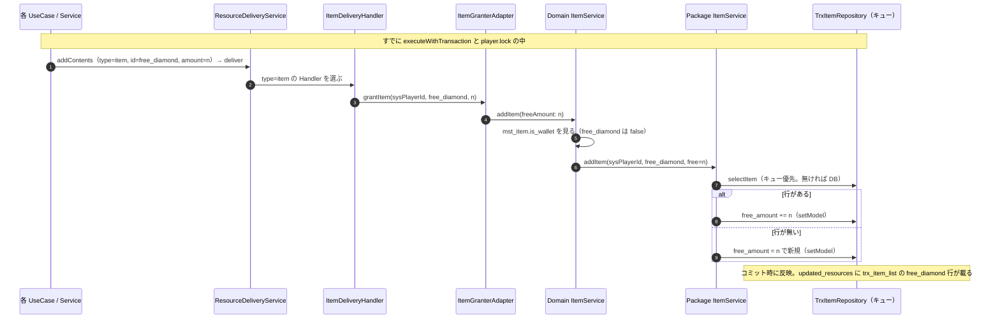
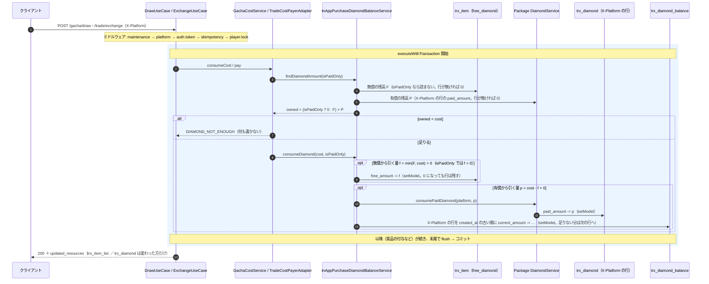
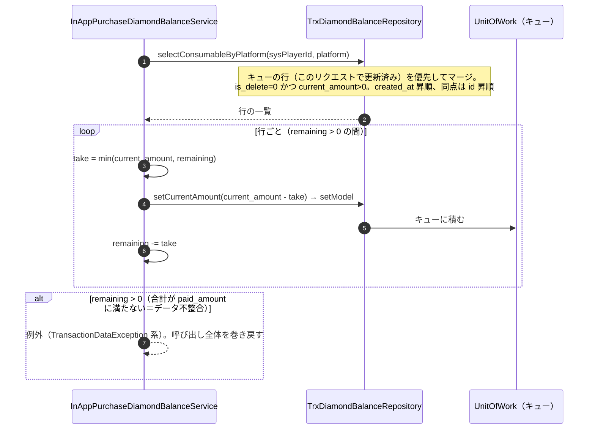
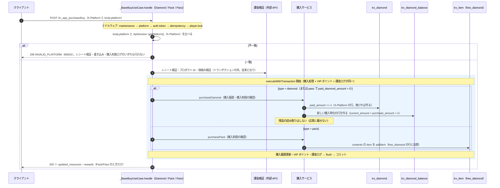

# 無償ダイヤの trx_item 管理への移行 シーケンス設計（S2）

機能 `free-diamond-item` のサーバーの通信シーケンス。対象は (1) 付与（無償 → `trx_item`、有償 → 購入だけ）、(2) 消費（無償 → 有償、`X-Platform` の行だけ、`trx_diamond_balance` の FIFO、同一トランザクション）、(3) 購入（platform 不一致エラー、有償付与 + balance 作成、パックの無償）、(4) 主要な異常系とトランザクション境界、(5) U-2（ロック外の呼び出し元）。

- 要件: `Nexus/docs/requirements/free-diamond-item.md`（**仕様の正本**。F / C / Q の節番号で指す）、全体設計: `Nexus/docs/design/free-diamond-item/overview.md`
- DB: [db.md](db.md)、API: [api.md](api.md)
- 手本: [home-player-info の sequence.md](../home-player-info/sequence.md)。ミドルウェアの順序・login の基本の流れは複製せず、差分だけ書く
- 「読んだ」= コードを読んだだけ。実行では確かめていない（開発 DB への書き込みはしない）。サーバーは main `f42dd2e7`

## 0. 共通の前提（読んだ）

- ゲーム API の書き込みは `maintenance` → `platform`（`X-Platform` を検証して `ApiSession` に載せる）→ `auth.token` → `idempotency` → `player.lock`（`routes/api.php:50,84`）。login・購入・ガチャ・交換・メール受け取り・ミッション・報酬トラックはすべてこの中にある。
- 書き込みは `executeWithTransaction()` の中で Repository の `setModel()`（UnitOfWork のキューに積む）。**DB への反映はコミット時にまとめて行う**。途中で例外が出ればキューを捨てて巻き戻す。`updated_resources` は、**コミット時にキューから INSERT / UPDATE された行**を `UpdatedResources` が集める。つまり「変更のあった方だけ載る」（F15・Q15）は、**変えなかった行に `setModel` しない**ことで保つ。
- 読み取りは Repository の `select*`（キュー優先）を通す。同じトランザクションで 2 回加算・消費しても、2 回目が 1 回目の結果から計算できる（`NoDirectTrxReadInDomainTest`）。

## 1. 付与

### 1.1 無償ダイヤ: `item` / `free_diamond` の一本の経路（F1）

報酬の種類（ログインボーナス・VIP・ミッション・報酬トラック・交換の景品・メール添付・ガチャの景品・課金パックの中身）によらず、入口は 1 つ。

- 付与の量は `Resource` の `amount`。期限（`expireAt`）は非 Wallet のアイテムでは使われない（読んだ。要件 F1）。
- **課金パックの中身**は `ResourceDeliveryService` を通らず、`InAppPurchasePackService` が `itemInventory->addItem(...)` を直接呼ぶ（`item` の分岐。読んだ）。F2 で `free_diamond` の分岐（`InAppPurchaseDiamondBalanceService::addDiamond(..., isPaid: false)`）を無くし、この `item` の分岐に統一する。付与後の経路は上の 4〜8 と同じ。
- **ハンドラの失敗は握りつぶされる（既存の挙動。変えない）**: `ResourceDeliveryService::execDeliveryIteration` は Handler の例外を `Log::error` して `markAsSendComplete` するだけで、再スローしない（読んだ）。`addItem` 自体は `setModel` でキューに積むだけなので、Handler で失敗するのは付与先の解決（`mst_item` の参照など）に限る。コミット時の書き込みの失敗は握りつぶされず、トランザクションごと巻き戻る。メール受け取りだけは `getTotalCount() === 0` を `INTERNAL_ERROR` にする。この性質は無償ダイヤに限らない全アイテムの既存の挙動で、この機能では扱わない。
- サインアップの初期 50 は `InitialGrantService` がパッケージ版 `addItem` を直接呼ぶ（実装済み。同じ行を使う。**付与と初期付与が同じ 1 行**で、ログインボーナスの加算はそこに足される）。
- 未知の type（廃止した `diamond`）が来たら、`Resource::fromTypeString` / `ResourceDeliveryContent::fromArray` が `ValueError`（Invalid resource type）を投げる（読んだ。db.md 6.2 節）。

### 1.2 有償ダイヤ: 購入だけ（ゲーム内の通常の付与。前提表・Q24）

- 付与の経路は `/in_app_purchase/buy` の `mst_in_app_purchase.paid_diamond_amount`（`type = diamond`、および `pass` で `> 0`）だけ（3 節）。
- `PAID_DIAMOND` の type と `DiamondDeliveryHandler` の有償分岐は残す（将来の運営ツールからの調整用。Q24。**その機能は別機能**）。変更は、`DiamondDeliveryHandler` が**有償だけ**を扱う形になること（`supports` は `PAID_DIAMOND` だけ。`isPaid` の分岐を無くし、`DiamondService::addPaidDiamond` を呼ぶ）。platform の決め方（`metadata['platform']` → `X-Platform` → `Apple`）は従来どおり。**この経路は `trx_diamond_balance` の行を作らない**（読んだ。Q23 に従い、運営の調整分は購入単位を持たない。運営調整は `paid_amount` と balance を両方整合させて操作する想定（別機能。この経路を調整の入口に使うかも別機能で決める。db.md 9 節 U-S4 確定））。
- 購入は `DiamondDeliveryHandler` を通らず `addPaidDiamondWithBalance` を直接呼ぶ（3 節）。

## 2. サービス構成の変更（消費・付与の入口）

要件 F6 の「Q2 の無償 → 有償の順を保つ入口は設計で決める」への答え。

| 層 | クラス | 責務（変更後） |
| --- | --- | --- |
| パッケージ | `Nexus\Core\Resource\Services\DiamondService` | **有償だけ**。`findPaidAmount(sysPlayerId, platform): int`、`addPaidDiamond(sysPlayerId, platform, amount): DiamondBalance`、`consumePaidDiamond(sysPlayerId, platform, amount): void`（その platform の行だけ。足りなければ例外）。`isPaid`・`free_amount`・全 platform の合算・無償 → 有償の順は無くす。`DiamondRepositoryInterface` に変更なし（`selectAllByPlayerId` は呼び出し元が無くなっても削除せずテストで固定する。規約） |
| Domain | `App\Domain\InAppPurchase\Services\InAppPurchaseDiamondBalanceService`（`DiamondBalanceInterface` の実装） | **無償 → 有償の順の入口**。無償は `trx_item` の `free_diamond`（パッケージ版 `ItemService` を直接）、有償は `DiamondService` と `trx_diamond_balance`（FIFO）を同じトランザクションで扱う。platform は `ApiSession::getPlatform()`（db.md 9 節 U-S5） |
| Domain | `DiamondBalanceInterface`（`App\Domain\InAppPurchase\Contracts`） | `findDiamondAmount(sysPlayerId, isPaidOnly)`・`consumeDiamond(sysPlayerId, amount, isPaidOnly)` は引数を変えない（ガチャ・交換は変更なし）。`addDiamond(..., isPaid)` は `addPaidDiamond(sysPlayerId, platform, amount)` に置き換える（無償の付与はアイテム経路になるため） |
| Domain | `ItemService`（`ItemInventoryInterface` の実装） | `consumeItem` の先頭で `free_diamond` を拒否（db.md 6.4 節。U-3） |

- **無償の消費がパッケージ版 `ItemService::consumeItem` を直接呼ぶ**のは、`ItemInventoryInterface` 経由だと、上のガードに自分で当たるため。`InitialGrantService` がパッケージ版 `addItem` を直接呼ぶ前例と同じ形。`NexusCore\...` は Domain から参照してよい（`ModuleBoundaryTest` の対象は `App\Domain\{Other}\` の内部クラス）。
- 付与側の入口は 1.1 のとおりアイテム経路で、`InAppPurchaseDiamondBalanceService` には無償の付与口を残さない（`addDiamond` の `isPaid: false` の経路は F2 で無くなる）。
- `findFreeAmount` は**足さない**（購入の応答に `total_free_diamond_amount` を載せない決定により、購入側で `free_diamond` の残高を読まない。消費の判定は 3.1 節のとおり `trx_item` を直接読む）。

## 3. 消費（ガチャ・交換のコスト `diamond` / `paid_diamond`。F5・F12・F14・F15）

### 3.1 全体の流れ

### 3.2 規則（読んだ現状と、変えるもの）

- **無償の行が無いときの分岐**: パッケージ版 `ItemService::consumeItem` は行が無いと `\Exception('Item not found')` を投げる。消費サービスは先に F を判定し、**行が無い・`F = 0`・`f = 0`（`isPaidOnly` を含む）のときは呼ばない**。`f > 0` のときだけ呼ぶ。
- **対象**: 有償は `X-Platform` の `trx_diamond` の行だけ。他 platform の行は**読まず、触らない**（F12。現状 C2・C3 の「全 platform の合算」を改める）。無償は platform 共通。
- **順序**（Q2）: コスト `diamond` は無償 → 有償。コスト `paid_diamond` は有償のみ（`isPaidOnly = true`）。無償を引く量は `min(F, cost)`、残りが有償。
- **判定の二重化**: 呼び出し側（`GachaCostService`・`TradeCostPayerAdapter`）が先に `findDiamondAmount` で残高を確かめ、足りなければ `DIAMOND_NOT_ENOUGH`（ガチャは `BusinessLogicException::diamondNotEnough`、交換は `GameException`）。この判定は**何も書く前**。`consumeDiamond` 側も同じ合計を再確認し、足りなければ汎用例外（プレイヤーロック内で同時更新は無いので通常は起きない。現行の `DiamondService` と同じ構え）。
- **`updated_resources` に載る行**（F15）: 無償だけを引いたら `trx_item_list`（`free_diamond` の 1 行）だけ。有償だけなら単数 `trx_diamond` だけ（`trx_diamond_balance` は `ReturnedAsUpdatedResource` を付けないので載らない）。無償 → 有償にまたがったときだけ両方。**引く量が 0 の側には `setModel` しない**（`f = 0` なら `trx_item` を触らない。`p = 0` なら `trx_diamond` と balance を触らない）。景品の付与（ガチャ・交換）が `free_diamond` を含むときは、同じ行が付与と消費で 1 件にまとまり、最後の状態が載る（`UpdatedResources` の仕様。読んだ）。
- **無償の行を使い切っても削除しない**（F5・Q8）。`free_amount = 0` で残る。
- **コストの `item`**: `cost_mst_id = free_diamond` は拒否（db.md 6.4 節。U-3）。

### 3.3 `trx_diamond_balance` の FIFO（F14・Q21）

有償の消費 `p` のうち、`trx_diamond.paid_amount` を減らすのと**同じ呼び出しの中**で行う。

- `billing_platform` では区別しない（Q21）。`platform` が `X-Platform` と一致する行だけ。
- 行は 0 になっても消さない。`trx_diamond_balance` は `updated_resources` に載らない。
- 引ききれない場合は `DIAMOND_NOT_ENOUGH` ではなく**データ不整合の例外**で、`paid_amount` の減算（キュー）ごと巻き戻す（**確定**。db.md 9 節 U-S4）。運営調整は `paid_amount` と balance を両方整合させて操作する想定（別機能）なので、合計 = `paid_amount` の前提は保たれる。
- 同点（同じ秒に作られた行）の並びは `id` の昇順。TiDB モードでは `id` が UUID で作成順にならない（`.claude/database.md` 11 節）ので、同じ秒の行の引く順は保証しない。購入は同じプレイヤーでロックされ直列なので、同じ秒に 2 行作られる状況は通常起きない（許容。仮置き）。

### 3.4 呼び出し元の確認（変更の波及）

| 呼び出し元 | 変更 |
| --- | --- |
| `GachaCostService`（`DrawUseCase`。トランザクション内 `DrawUseCase.php:59`） | `DiamondBalanceInterface` の引数が変わらないので**コードの変更なし**。`updated_resources` が新しい形になる（api.md 4 節） |
| `TradeCostPayerAdapter`（`ExchangeUseCase`。トランザクション内） | 同上 |
| `GachaCostService::consumeItem`・`TradeCostPayerAdapter::payItem` | `free_diamond` を拒否（ガードは `ItemService::consumeItem` の中。呼び出し元のコードは変えない） |

## 4. 購入（`/in_app_purchase/buy`。F2・F3・F13）

`BuyRequest` は body の `platform`（`Apple` / `Google`）を残す（検証は `in:Apple,Google`）。`InAppPurchaseController::buy` は値を取り出して UseCase に渡すだけ（変更なし）。**一致の検証は `_BaseBuyUseCase::handle` の最初**に置く。

- **不一致のエラー（F13・Q19）**: `INVALID_PLATFORM`（99003。HTTP 299）。メッセージは欠落・不正（`ResolvePlatform` の `X-Platform header is required.` など）と区別できる文言にする（例: `platform in body does not match X-Platform`）。**Slack 通知は出さない形にする**（人の決定。U-Q3）。`_BaseController::execute()`（`_BaseController.php:88-103`）は `GameException` を捕捉して `notifySlack` する（確認済み）ので、通常の `GameException` で投げると通知される。通知を避けて `ErrorResponse` を直接返す等、`ResolvePlatform` の意図に合わせる。手段は S3 で決める。
- **なぜ検証の前に置くか**: 検証後（`processPurchase`）に弾くと、ストアの決済は成立しているのに付与されない。検証の前に拒否すれば、決済のレシートは未消費のままで、クライアントが同じ値を送り直せる。`writeFailedPurchaseLog`（`try` の中で作る失敗ログ）も出さない（クライアントの実装の誤りで、購入の失敗ではない。仮置き。9 節）。
- **一致したあと**の加算先は `X-Platform` の行と同じになる（F13）。`BuyEndpointTest` の「Apple でログインし body `platform = Google` で購入すると Google の行に入る」は不一致エラーのテストに変わる。
- **有償ダイヤの購入**（`InAppPurchaseDiamondService::purchaseDiamond`）: `addPaidDiamondWithBalance`（`DiamondService::addPaidDiamond` ＋ `trx_diamond_balance` の行の作成）。**応答から `paid_diamond_amount` を外し**（B）、サービスの戻り値の `paid_diamond_amount`・`total_*` と、それ用の残高の読み取り（`findBalance`）も無くす。購入した量は `updated_resources.trx_diamond` で分かる。マスター列 `mst_in_app_purchase.paid_diamond_amount` は付与量として引き続き使う。
- **パック**（`purchasePack`）: `free_diamond` の分岐が無くなり、`item` の分岐で `free_diamond` も加算する（`rewards` の表現は api.md 5 節）。戻り値の `total_free_diamond_amount` と集計は無くす（残高は `updated_resources.trx_item_list` で返る）。**パックでは `trx_diamond_balance` の行を作らない**（有償ダイヤはパックの中身に入れられない。db.md 5 節）。
- **応答に `total_*_diamond_amount` と `paid_diamond_amount` を載せない**（人の決定 B。U-S1 解決）。応答は `updated_resources` と `rewards` だけ（api.md 5.3 節）。
- 購入履歴・購入制限の確認（`validatePurchaseLimit`）・VIP ポイント・課金ログは**変更なし**。同一トランザクションのまま。

## 5. 主要な異常系

| 状況 | どうなるか | エラー・結果 |
| --- | --- | --- |
| 消費の残高不足（有償 `X-Platform` の行 ＋ 無償 < コスト。コスト `paid_diamond` なら有償だけ） | 何も書かない。`updated_resources` なし | `DIAMOND_NOT_ENOUGH`（1902。ガチャ `BusinessLogicException`、交換 `GameException`） |
| 他 platform にだけ有償がある | 有償 0 として判定（F12）。足りなければ上と同じ | `DIAMOND_NOT_ENOUGH` |
| `trx_diamond` に `X-Platform` の行が無い | 有償 0。無償だけで足りれば消費できる（無償は `trx_item`） | 足りなければ `DIAMOND_NOT_ENOUGH` |
| `trx_item` に `free_diamond` の行が無い | 無償 0 として判定。消費では行を作らない | 同上 |
| コストの途中で失敗（景品の付与・他の書き込みの例外） | キューを破棄。無償・有償・balance のすべてが戻る | 例外に応じたエラー。DB は変わらない |
| コスト `item` で `free_diamond` を指す（ガチャ・交換のマスターの誤り） | 何も変更せず拒否（db.md 6.4 節） | `INVALID_ITEM_TYPE`（1903）。所持数が足りないとき先に `ITEM_NOT_ENOUGH`（許容） |
| `/item/use`・レベルアップに `free_diamond` を指定 | 従来どおり `effect = none` で拒否（ガードでも二重に拒否） | `INVALID_ITEM_TYPE` |
| `trx_diamond_balance` の合計が `paid_amount` に満たない（データ不整合） | 例外。無償・有償・balance のすべてを巻き戻す | `TransactionDataException` 系（`DIAMOND_NOT_ENOUGH` ではない。確定。db.md 9 節 U-S4） |
| 購入: body の `platform` ≠ `X-Platform` | 検証の前に拒否。何も書かない・外部呼び出しもしない | `INVALID_PLATFORM`（99003）。メッセージで区別 |
| 購入: `X-Platform` の欠落・不正 | `ResolvePlatform` が先に拒否（購入の UseCase に届かない） | `INVALID_PLATFORM`（既存） |
| 購入: 購入制限・レシート・価格・プロダクト ID の失敗 | 従来どおり。購入失敗ログを書く | 既存のエラー |
| 付与の type が未知（廃止した `diamond`） | 配布時に `ValueError`（1.1） | 500 系。マスターを `item` / `free_diamond` に直す |
| 付与の Handler 内の失敗 | 握りつぶされる（既存。1.1） | 変更なし |
| 同時リクエスト（同じプレイヤー） | `player.lock` で直列。待ち切れなければ 409（40900）、Redis が不通なら 503（50300） | 既存 |

## 6. トランザクション境界

| 処理 | 範囲 | 失敗時 |
| --- | --- | --- |
| ガチャ・交換 | `executeWithTransaction` の 1 つ。コストの消費（`trx_item`・`trx_diamond`・`trx_diamond_balance`）と景品の付与・履歴・ログが同じトランザクション。同じプレイヤーのシャード（`trxN`）に収まる（`sys` も同時に開始される。読んだ） | すべて巻き戻る |
| 購入 | レシート検証（外部 API）は**トランザクションの外**。付与・VIP ポイント・課金ログが 1 つのトランザクション | 検証失敗は書き込みなし。付与の失敗はロールバックし、失敗ログだけ別に書く（既存。`writeFailedPurchaseLog`） |
| 付与（ログインボーナス・メール・ミッションなど） | 各 UseCase の `executeWithTransaction` の中 | すべて巻き戻る |
| platform の不一致 | トランザクションの前 | 何も起きない |

- DB への反映は**コミット時のフラッシュ 1 回**（UnitOfWork のキュー）。消費の途中で例外が出たら、無償・有償・balance のどれも書かれない。
- 付与と消費の順序が 1 リクエストの中にあるとき（交換の景品が `free_diamond` を含むなど）、`trx_item` の `free_diamond` の行は 1 行なので 1 件にまとまり、最後の状態が `updated_resources` に載る。

## 7. U-2: ダイヤの付与・消費がロック外から呼ばれる経路（読んだ）

**結論: ロック外の書き込み経路は無い。行ロックは足さない**（`LockPlayerRequest` のコメント「行ロックは漏れやすく、プレイヤー単位の直列化のほうが確実」と整合）。

| 経路 | ロックの内外 | 評価 |
| --- | --- | --- |
| login・購入・ガチャ・交換・メール受け取り・ミッション・報酬トラック・`/item/use`・レベルアップ | `auth.token` → `idempotency` → `player.lock` のグループの中（`routes/api.php:84`） | 直列。問題なし |
| GET（`/player/me`・`/mailbox/list` ほか） | ロックは GET を通す（`LockPlayerRequest::handle` は GET を対象外にする） | ダイヤ・`trx_item` を書く GET は無い（`trx_diamond` / `free_diamond` を書く処理は、上の POST と `sign_up` だけ。全体設計で確認済み） |
| `sign_up`（`SignUpUseCase` → `InitialGrantService`） | ロックのグループの外（未認証。`client.signature` + `throttle.signup`） | 新規プレイヤーを作る処理で、同じプレイヤーに他のリクエストが競合しない（トークン発行前）。`executeWithTransaction` の中 |
| ドメインイベントのリスナー | リクエストの中で同期実行（`Dispatcher`） | `ItemInventoryInterface`・`ItemGranterInterface`・`DiamondBalanceInterface` を使うリスナーは無い（`app/Domain/*/Listeners` を検索して 0 件）。VIP レベルアップ報酬（`VipLevelUpEvent`）は報酬を運ぶだけで、受け手が付与しない |
| コンソールコマンド（`app/Console/Commands`） | ロックの外 | `Billing/DetectRefundsCommand`・`Mailbox/DeleteExpiredCommand`・`Sharding/AssignPlayersCommand`・`MigrateShards*` は `trx_diamond`・`trx_diamond_balance`・`free_diamond` を書かない。`Wallet/MigrateItemsCommand` は `is_wallet = true` のアイテムだけ移す（`free_diamond` は `is_wallet = false` なので対象外。`whereIn('mst_item_id', $walletItemIds)`） |
| 運営ツール（`tool/`） | 別アプリ | ダイヤ・`trx_item` を書く処理は無い（`PlayerHistoryController` はログの一覧のみ） |
| シーダー | `TrxItemSeeder`（`trx_item`。開発用）・`RecordingLoginBonusSeeder`（mst） | 開発環境の作り直し用で、リクエストと競合しない |

- ロックの前提（既存）: プレイヤーごとの Redis ロック（`player_request:{id}`、保持 30 秒、待ち 5 秒）。ロックが取れない・Redis が不通なら**通さない**（409 / 503）。保持の 30 秒を超える処理は理論上ロックが外れるが、既存の前提で変えない。
- 将来、バッチ・運営ツールから `free_diamond` / `trx_diamond` を書く機能（Q24 の返金調整など）を足すときは、その機能の設計でロックの方法（同じ `player_request:{id}` を取るなど）を決める。この機能の対象外。

## 8. 未解決点

要件の確認事項はすべて解決済み。この設計で新しく出た点は [db.md](db.md) 9 節（U-S1〜U-S7）に集約している。シーケンス固有で追加する点は次のとおり。

| # | 確認事項 | 既定案 |
| --- | --- | --- |
| U-Q1 | 購入の platform 不一致を、購入失敗ログ（`log_in_app_purchase` の失敗行）に残すか | **残さない**。レシート検証の前に拒否し、クライアントの実装の誤りとして扱う。CS 調査で必要なら、検証前でも書ける形に S3 で変える |
| （U-Q2 は欠番） | `DiamondDeliveryHandler` の `PAID_DIAMOND` 経路が balance 行を作らないことは、db.md 9 節 U-S4（確定）に統合した。運営調整が `paid_amount` と balance を両方整合させる前提で、この経路を入口に使うかは別機能で決める | 別機能 |
| ~~U-Q3~~（確定） | **確定（人の決定）: 通知しない**。事実: `_BaseController::execute()` は `GameException` を捕捉して `notifySlack` するので、通常の `GameException` では通知される。したがって**通知しない形にする**（`ResolvePlatform` のように `ErrorResponse` を直接返す等。実装手段は S3 で決める） | 実装は S3 |
