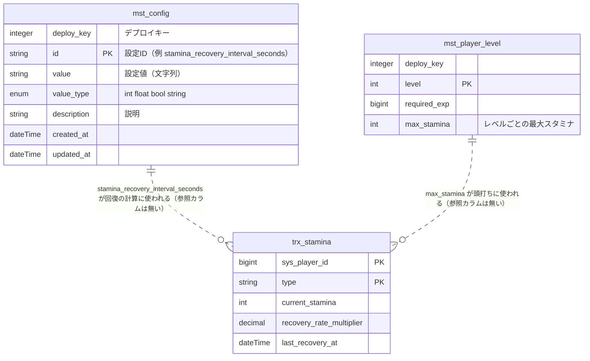

# ホーム＋プレイヤー情報 DB 設計（S2）

機能 `home-player-info` のサーバー側 DB 設計。対象は **新しい mst テーブル `mst_config`（MstConfig）の新設**と、その値で置き換える**スタミナ回復間隔（300 秒）**、および人の追加依頼（Q9）による**サインアップ時の初期データ**の値の持ち方。新しいテーブルは `mst_config` の 1 つだけで、既存テーブルは変更しない。

- 全体設計: `Nexus/docs/design/home-player-info/overview.md`（Nexus リポジトリ。マージ済み）
- API: [api.md](api.md)、シーケンス: [sequence.md](sequence.md)
- 既存の関連設計: [title-to-home の db.md](../title-to-home/db.md)
- DB 全般の規約: `.claude/database.md`
- 確かめ方の凡例: 「実行」= 開発環境のコンテナで読み取りだけを実行して確認した。「読んだ」= コードを読んだだけ。「未確認」= どちらもできていない。開発 DB への書き込み（seed・migrate・login など）は行っていない。

## 1. 対象と結論

| 項目 | 内容 |
| --- | --- |
| 新設 | `mst_config`（接続 `mst`）。キーと値の設定表。最初の行は `stamina_recovery_interval_seconds` = 300 |
| 値の置き場所 | **MstConfig の行 1 つ**。コード上の既定値（行が無いときの値）は `MstConfigKey` の 1 か所にだけ置く（3 節） |
| 置き換える 300 秒 | 3 ファイル・計 7 参照（2 節）。すべて同じ読み出し口（`StaminaRecoveryIntervalProviderInterface`）を通す |
| P5（行が無いとき） | **既定値（300 秒）で続け、警告ログを出す**（理由は 4 節） |
| U5（版ずれ） | サーバーは常に自分の MstConfig（Redis キャッシュ込み）で計算する。クライアントとのずれは次の login で直る（5 節） |
| 他に変えるもの | `mst_item` に `free_diamond` の行を 1 つ足す（8.5 節。Q17）。`mst_player_level` は既存のまま使う。サインアップ時の初期付与の値は MstConfig に持たず、コードの定数にまとめる（8.2 節。Q15） |
| マイグレーション | `packages/nexus-core/database/migrations/mst/2026_01_01_000001_create_config_tables.php`（新規ファイル） |

## 2. 回復間隔の置き換え範囲（確定）

現行の 300 秒は private 定数が 3 か所にあり、実行で参照されるのは次の 7 か所（読んだ）。

| # | ファイル（`NexusLaravelMobileGameServer/` 起点） | 定義行 | 参照 | 用途 |
| --- | --- | --- | --- | --- |
| 1 | `packages/nexus-stamina/src/Services/StaminaService.php` | 21 | `applyAutoRecovery`（回復点数の計算・`last_recovery_at` の前進）、`calcTimeUntilNextRecovery`（残り秒数） | **login が使う経路**（`HomeUseCase` → `findAllStaminas`）、消費・アイテム回復の前の自然回復 |
| 2 | `api/app/Domain/Stamina/Services/StaminaService.php` | 23 | `calcTimeToFullRecovery`（満タンまでの秒数） | Domain 層のラッパー |
| 3 | `api/app/Domain/Stamina/Listeners/RecoverStaminaOnPlayerLevelUp.php` | 29 | `applyAutoRecovery`（パッケージ版の写し）の 2 か所 | レベルアップ時に、加算の前に自然回復を反映する |

上記以外に回復間隔を表す数値の直書きは見つからなかった（`grep` で `RECOVERY_INTERVAL` と stamina/recover まわりの 300 を検索。読んだ）。テストの定数は 6 節。

### 置き換えの方針

1. **読み出し口を 1 つにする**。`nexus-stamina` パッケージに契約 `NexusStamina\Services\StaminaRecoveryIntervalProviderInterface`（`findRecoveryIntervalSeconds(): int`。常に 1 以上の整数を返す）を足す。パッケージは `nexus/core` にしか依存できない（`PackageIndependenceTest`）ので、既存の `PlayerLevelServiceInterface` と同じく、実装はアプリ側のアダプタ（`App\Domain\Stamina\Services\StaminaRecoveryIntervalAdapter`。仮置き）で `AppServiceProvider` の「NexusStamina Package Bindings」に束縛する。
2. 3 か所の private 定数と参照をすべて、この契約の値に置き換える。**定数は 3 つとも削除する**（残さない）。
3. アダプタは `MstConfigService`（アプリ側。3 節）から値を取るだけ。既定値はアダプタにも書かない。
4. 読み出し回数: 値は**1 回の `findAllStaminas` / `calcTimeUntilNextRecovery` につき 1 回だけ**読み、`applyAutoRecovery` には引数で渡す（スタミナ 4 種の行ごとに読み直さない = N+1 にしない）。アダプタ自身も 1 リクエスト内でメモ化する（`scoped` で束縛）。MstConfig のテーブル全体は `_BaseMstRepository::queryOrMemory()` が Redis に 1 キー（`mst:mst_config:all`、TTL 3600 秒）で持つので、リクエスト内の実読み出しは Redis の GET 1 回以下で、ミス時だけ mst DB に SELECT 1 回。
5. リスナー内の `applyAutoRecovery`（パッケージ版と同じ計算の写し）は、本機能では**計算を変えず値の出どころだけ**変える。重複の解消はこの設計の対象外（別の整理。未解決点 U-A）。

## 3. MstConfig（`mst_config`）の設計

### 3.1 キーと値の持ち方（決定と理由）

**キーと値の 1 行 1 設定。値は文字列の `value` に入れ、型は `value_type` で持つ。**

| 案 | 内容 | 採否 |
| --- | --- | --- |
| A 型付きの列（`int_value` / `string_value` ...） | 設定ごとにどれかの列だけを使う | 不採用。ほとんどの列が NULL になる。設定が増えるたびに「どの列か」を知る必要がある |
| **B `value`（文字列）＋ `value_type`** | 全設定を 1 列の文字列に入れ、読む側が型で解釈する | **採用** |
| C 設定ごとに専用テーブル | | 不採用。設定 1 件ごとにテーブル・マイグレーション・配信ファイルが増える |

B を選んだ理由と、型の安全性の担保:

- 設定の追加がマスターの行追加だけで済む（マイグレーションが要らない）。クライアントも同じ表を読む。
- 配信 SQLite への書き出し（`MasterDataExporter::buildCreateTableSql`）は MySQL の型を `INTEGER`（int 系）/ `REAL`（decimal・float 系）/ `TEXT`（その他）に機械的に写す（読んだ）。`value` は varchar なので `TEXT` になり、**型付きの列にしても SQLite 上の型はこの 3 種に丸められる**。つまり型付き列にしても配信先の型安全性は上がらない。
- 型の検査はサーバー側の `MstConfigService` が行う: `value_type` が要求した型と違う、または値が型として解釈できない（整数でない文字列、整数設定で 0 以下など、設定ごとの検証）場合は「値なし」と同じに扱う（4 節）。型の判定をアプリ 1 か所に集める。
- `value_type` は mst なので ENUM にしてよい（`.claude/database.md` 5 節。ENUM は mst / adm / tol だけ許可）。

**配信されるのは mst の全行である点に注意**: `mst_config` は `mst_*` として**全行がクライアントに配信される**（クライアントの SQLite になる）。秘密情報（鍵・内部 URL など）を入れてはならない。クライアントに見せたくない設定は mst_config に置かない。

### 3.2 テーブル定義

テーブル `mst_config`、接続 `mst`（`_BaseMst` が固定）。

| カラム | 型 | null | 既定 | 索引 | コメント |
| --- | --- | --- | --- | --- | --- |
| deploy_key | integer | 不可 | 202601010 | index | デプロイキー（既存 mst と同じ書き方） |
| id | string（varchar(255)） | 不可 | - | PK | 設定 ID（人が決める安定した文字列。スネークケース） |
| value | string（varchar(255)） | 不可 | - | - | 設定値（文字列。`value_type` で解釈する） |
| value_type | enum('int', 'float', 'bool', 'string') | 不可 | - | - | 値の型（int=整数、float=小数、bool=`true`/`false`、string=文字列） |
| description | string（varchar(255)） | 不可 | - | - | 設定の説明（運用者向け。何に使い、どの単位か） |
| created_at | dateTime | 不可 | CURRENT_TIMESTAMP | - | 作成日時 |
| updated_at | dateTime | 不可 | CURRENT_TIMESTAMP ON UPDATE CURRENT_TIMESTAMP | - | 更新日時 |

- 主キーは `string('id')->primary()`。**AUTO_INCREMENT は使わない**（`$table->id()` / `increments` / `->autoIncrement()` を書かない）。`MstNoAutoIncrementIdTest` が `packages/*/database/migrations/mst/` を走査して検査する。新規ファイルをその下に置くので検査の対象に入る。
- 外部キーは張らない。他テーブルを指すカラムは無い。
- 全カラムに `->comment()` を付ける。`value_type` のコメントに取りうる値を書く。
- 索引は `deploy_key` のみ（`id` は PK）。設定は数十行までの想定で、全行を Redis に載せて読むため他の索引は要らない。
- `__l10n`（多言語）は作らない（設定値は言語に依らない）。
- モデルは `App\Models\Mst\MstConfig`（`$primaryKey = 'id'`、`$keyType = 'string'`、`$incrementing = false`。`MstItem` と同じ形）、Repository は `App\Repositories\Mst\MstConfigRepository`（`_BaseMstRepository`。`modelClass` だけ）。キーの宣言は Model 側に置く（`RepositoryKeyDeclarationTest`）。

### 3.3 設定 ID と初期データ

ID は命名規約（スネークケース、単位は末尾に付ける）に従い、設定の種類をコードの 1 か所（`App\Domain\MstConfig\Constants\MstConfigKey`。string の enum。仮置き）にまとめる。各 case が「ID」「値の型」「**行が無いとき・不正なときの既定値**」を持つ。**既定値の置き場所はここだけ**（シーダー・アダプタ・テストはこれを参照する）。

| ID | value_type | 初期値 | 既定値（行なし・不正時） | 説明 |
| --- | --- | --- | --- | --- |
| `stamina_recovery_interval_seconds` | int | `300` | `300` | スタミナが 1 回復する間隔（秒）。`recovery_rate_multiplier` で割る前の基本値。1 以上の整数 |

サインアップ時の初期付与の値（Coin 1000・無償ダイヤ 50）は MstConfig に**持たない**（人の決定 Q15。8.2 節）。MstConfig の行は回復間隔だけ。

### 3.4 シーダー

- `api/database/seeders/MstConfigSeeder.php` を新設し、`DatabaseSeeder` の Phase 1（マスターデータ）に、`MstPlayerLevelSeeder` などの後に足す（他の mst への依存は無い）。
- **冪等**: 他の mst シーダー（`MstItemSeeder` など）と同じく `_BaseMst::allowWrites()` → 対象テーブルだけ `truncate()` → INSERT。何度流しても同じ結果になる。`mst_config` だけを truncate し、他のマスターには触れない。
- 行は `MstConfigKey` の全 case から作る（初期値 = 既定値）。`deploy_key` は他の mst シーダーと同じ定数（202601010）。
- 運営ツール（スプレッドシートのインポート）は「シート名 = テーブル名で、truncate して再 INSERT」（`MasterImportService`。読んだ）。**`mst_config` のシートを作ると、シートに無い行は消える**ので、シートには全設定の行を入れること（行が消えた場合の動きが P5。4 節）。

### 3.5 マイグレーションの置き場所と方針

- 置き場所: **`packages/nexus-core/database/migrations/mst/2026_01_01_000001_create_config_tables.php`**（新規ファイル）。
  - 理由: `mst_config` は stamina 専用ではなく、複数の機能（スタミナ、サインアップの初期データ、今後の設定）が読む**汎用の設定表**。`nexus-stamina` に置くと、他の機能が stamina パッケージのマイグレーションに依存する形になる。汎用の mst（`mst_item` など）は `nexus-core` の mst に置かれている前例（`2026_01_01_000001_create_resource_tables.php`）に合わせる。
  - `make migrate` は `Makefile` の `migrate_group` が `../packages/*/database/migrations/mst` を `--path` に渡すので、`nexus-core/database/migrations/mst/` に置けば読まれる（読んだ）。S3 では `make migrate` の実行だけ確認する（U-F）。
- 方針: 今は「共有の検証環境を作るまで既存ファイルを書き換えてよい」期間（`.claude/database.md` 3 節。凍結の日付の記載は無い）だが、**既存ファイルは書き換えず、新規ファイルとして足す**。新規ファイルなら、既存環境でも通常の `make migrate` で `mst_config` だけが作られ、`migrate-fresh` は要らない。凍結後に実装することになった場合は、ファイル名を `2026_MM_DD_HHMMSS_create_config_tables.php` に変える。
- ファイル名は他のパッケージの `create_{機能}_tables.php` と衝突しない（`config`）。`MigrationNameUniquenessTest` は trx と log の同名だけを見るので mst は対象外。
- `down()` は `Schema::dropIfExists('mst_config')`。

### 3.6 シャード・接続

`mst` は単一の接続（db-master）。シャード分割はしない（mst は全プレイヤー共通で、読み取り専用）。書き込みは運営ツールのインポートとシーダーだけ。

## 4. P5（MstConfig に値が無いとき）の確定

**推奨（確定案）: 既定値（300 秒）で続け、警告ログを 1 リクエストにつき 1 回出す。**「無い」には、行が無い、`value_type` が `int` でない、値が整数に解釈できない、1 未満、の場合を含む。

| 案 | 内容 | 影響 |
| --- | --- | --- |
| **A 既定値で続ける＋警告ログ（推奨）** | 値が使えないとき `MstConfigKey` の既定値を返し `Log::warning` | login・消費・アイテム回復が止まらない。従来の挙動（300 秒）と同じ。運用の事故（行の消し忘れ）は警告ログで気づける |
| B 例外にする | 値が使えないとき例外 | login・消費・レベルアップが 500 になる。スタミナ 1 つの設定欠落で、ゲーム全体（login はすべての入口）が止まる |
| C 既定値で続ける（ログなし） | | 欠落に気づけない。配信値を 600 に変えたつもりで行が消えているとき、サーバーだけ 300 に戻って静かにずれる |

A を選ぶ理由:

- 欠落が現実に起きる: 運営ツールのインポートは truncate して再 INSERT なので、シートに行が無いと**行が消える**（3.4 節）。そのとき login が落ちるのは影響が大きすぎる。
- 既定値が従来値（300 秒）なので、導入前と同じ挙動に戻るだけ。
- 「0 以下・非整数」を既定値に倒すのは、**0 のまま使うと `intdiv` / 除算でゼロ除算になる**ため（回復点数 = 経過秒 ÷ 間隔）。
- A の弱点: 欠落中に消費・アイテム回復が走ると、既定値で計算した現在値と `last_recovery_at` が保存される（保存されるのは消費・回復アイテム使用・レベルアップのとき）。値は従来値なので、設定値が 300 のままなら正しい。**設定値を 300 以外に変えた後に行が消えた場合だけ**、保存値が配信値と食い違う。警告ログが対策。これを許容する（人の確認事項にはしないが、報告の「仮置き」に載せる）。
- S3 のテスト項目（初期付与）: **付与の失敗で sign_up 全体が失敗し、何も残らない**（api.md 5 節）。
- **S3 の範囲（D5 の追加分）**: login の `trx_diamond`（`HomeUseCase`・`HomeResponse`）、`DiamondDeliveryHandler` の既定 platform（`DefaultPlatformProviderInterface`・`ApiSession::hasPlatform()`）、テスト（login の `trx_diamond` が `X-Platform` の行だけ・行が無いとき `null`、Google ヘッダーでの付与が Google の行に入る、ジョブ経路は `Apple` にフォールバック）。詳細は api.md 11.3・11.4 節。付与の前に `ApiSession` の platform が載っていること（sign_up でも `ResolvePlatform` が先に載せる）が、初期付与の `trx_diamond` の行と、ログインボーナスの既定 platform の前提になる。
- 欠落の検知を確実にするため、S3 のテストに「`MstConfigSeeder` が全 case の行を作る」「既定値が初期値と一致する」を入れる。

クライアント側の P5（値が無ければ回復を計算せず、ログイン時の値だけ表示）は変えない（S4 の範囲）。

## 5. U5（版ずれ）の整理

**サーバーが計算に使う値**: 計算の時点の `mst_config` の値（`MstConfigService` が Redis キャッシュ越しに読む）。クライアントが持つ配信済みの値は使わない。クライアントから値を受け取る経路も作らない（改ざんの余地を作らない）。

**「サーバー側の MstConfig は常に最新」とは言えない（読んだ）**: `_BaseMstRepository::queryOrMemory()` は全行を Redis に **TTL 3600 秒**で持ち、運営ツールのインポート・エクスポート（`MasterImportService`・`MasterDeployService`）は**このキャッシュを消さない**（`tool/app` にキャッシュ操作が無いことを読んだ。開発では `make seed-recording-clear-cache` = `cache:clear` を手動で行う）。つまり、運営ツールで値を変えてから**最大 1 時間は、サーバーが古い値で計算し得る**。同じ性質は既存の `mst_player_level` にもある。

ずれの組み合わせと影響:

| 状況 | サーバーの値 | クライアントの値 | 影響 |
| --- | --- | --- | --- |
| 通常 | 同じ | 同じ | なし |
| マスター更新直後（クライアントが未更新） | 新（キャッシュが新しいとき） | 旧 | login 応答の `last_recovery_at` は新しい間隔で前進済み。クライアントは旧間隔で未反映分（回復 1 点ぶん未満）を計算する。差は「その 1 点が出るタイミング」だけで、二重加算にはならない |
| 運営ツール反映後、サーバーのキャッシュが古い | 旧 | 新（更新済み） | 逆向きのずれ。同じく差は 1 点ぶん未満のタイミング |
| いずれの場合も | | | 表示だけの差。**保存される値の正はサーバーの計算**（消費・回復の API は必ずサーバーの値を使う）。次の login・次の API 応答でサーバー値に置き換わる |

- ずれの大きさ: 最大でも「ログイン後に経過した時間 × 間隔の差」で、表示値が 1 点ずれる程度（間隔が大きく変わると増える）。値を変える運用は**通常は行わない**（overview の仮置き U5）。
- 変更する場合の手順（運用の前提）: ① 運営ツールで `mst_config` を更新し、エクスポート（配信）する。② サーバーの mst キャッシュを消す（`php artisan cache:clear` 相当。**本番での手順は未解決点 U-B。人の判断**）。③ クライアントは `X-Master-Update-Required` を受けて次のマスター更新で新しい値になる。
- S3 でキャッシュ無効化の仕組み（デプロイ時に `mst:*` を消すなど）は**作らない**（既存の `mst_player_level` と同じ運用に揃える。必要なら別機能）。

## 6. テストの更新対象

| テスト | 変更 |
| --- | --- |
| `api/tests/Feature/Domain/Stamina/Services/StaminaServiceTest.php`（Domain 層。`RECOVERY_INTERVAL_SECONDS = 300` を持つ。`calcTimeToFullRecovery` の 3 ケースと自然回復） | 定数を、`MstConfigKey` の既定値を参照するか、`mst_config` の行を入れて検証する形にする。**行を入れたとき（例 600 秒）に回復・満タンまでの秒数が変わること**を追加 |
| `packages/nexus-stamina/tests/Unit/Services/StaminaServiceTest.php` と `packages/nexus-stamina/tests/Unit/StaminaServiceTest.php`（2 ファイルある） | `StaminaService` のコンストラクタに `StaminaRecoveryIntervalProviderInterface` のモックを渡す。「300 秒で 1 点」の期待値はモックが 300 を返す前提に書き換え、別の値（例 600）を返すケースを追加 |
| `HomeSnapshotTest`（`api/tests/Feature/Login/`）、`StaminaAdapterTest`、`UseItemTest`、`ItemEndpointTest`、`PlayerLevelServiceTest`（api / package）、`CompositeUniqueKeyCacheTest` | `mst_config` の行が無くても既定値で通る（P5 の A）ので期待値は変わらない見込み。mst のテストは各テストで行を入れる流儀なので、必要なら `mst_config` の行を入れ、`MstConfigRepository::clearCache()` を呼ぶ |
| 新規 | (1) `MstConfigService`: 行あり・行なし・型違い・0 以下・非整数、警告ログ。(2) `MstConfigSeeder` が全 case を作り、2 回流しても同じ（冪等）。(3) リスナー `RecoverStaminaOnPlayerLevelUp` の回復計算が設定値を使う（現状このリスナーを直接検証するテストは見つからなかった。`PlayerLeveledUp` を発火する形で追加）。(4) `MstNoAutoIncrementIdTest`（既存）が通る |

## 7. ER 図

点線は「計算で使う」関係で、外部キー・参照カラムは無い（外部キー制約は張らない規約）。

## 8. サインアップ時の初期データ（Q9。人の追加依頼。Q15〜Q19 は 2026-11-14 に決定）

人の依頼（2026-11-14）: サインアップ時に `trx_diamond`（paid 0・free 0）、`trx_wallet`（Coin 1000）、`trx_item`（free_diamond 50）、`trx_stamina`（初期スタミナ = レベル 1 の最大値、type = normal、`last_recovery_at` = 作成時刻）へ 1 レコードずつ入れる。title-to-home の要件の「新規作成時の初期付与は対象外」を上書きする。**S3 の範囲が広がる**（sign_up のサーバー変更）。流れは [sequence.md](sequence.md) の 4 節、応答の変化は [api.md](api.md) の 4 節。

### 8.1 現行の事実（読んだ・実行）

- 現行の sign_up は sys だけに書く（`SignUpUseCase`。`sys_player` / `sys_sharding_node_player` / `sys_player_device` / `sys_player_token`）。trx は書かない（title-to-home の sequence.md と一致）。
- **Q9 の確定**: サインアップ直後の `trx_stamina_list` は**空**。`trx_stamina` の行を作る箇所は、`RecoverStaminaOnPlayerLevelUp::createStamina`（レベルアップ時）だけで、`initializeStamina` の呼び出しはテスト以外に無い（`api/app`・`packages/*/src` を `grep`。読んだ）。開発 DB は `trx1`・`trx2` のプレイヤー計 10 人で `trx_stamina` が 0 行（実行。ただしこれはシーダーのプレイヤーで、sign_up を実行した結果ではない。**sign_up → login の実行は書き込みになるため未実施**。確認の手順は api.md 5 節）。
- 派生する現行の問題: スタミナ行が無いとき、ログインボーナスのスタミナ報酬（`MstLoginBonusSeeder` の 5 日目 `stamina` 50）や回復アイテムは `recoverStaminaByItem` が「Stamina record not found」を返し、**呼び出し側（`StaminaGranterAdapter`）は結果を見ずに捨てる**ので、付与が黙って無くなる（読んだ）。初期スタミナの行を作れば解消する（影響として 9 節に載せる）。
- 現行のダイヤ・Coin・アイテムの付与の経路: `ResourceDeliveryService`（ログインボーナスが使っている）の各ハンドラ。`coin` は `CurrencyDeliveryHandler` → nexus-wallet の `CurrencyGranterInterface`、アイテムは `ItemDeliveryHandler` → `ItemGranterAdapter` → `ItemService::addItem`、ダイヤは `DiamondDeliveryHandler`（`platform` は metadata、無指定は `Apple`）→ `DiamondService::addDiamond`（行が無ければ作る）。
- **`ResourceDeliveryService` は初期付与に使わない（失敗を握りつぶすため）**: `execDeliveryIteration` は `$handler->handle()` の例外を `catch (\Throwable)` でログに出すだけで、送信済みにして続行し、**投げ直さない**（`deliver()` が投げるのは、上限超過のポリシーが設定されているときの `checkAndThrowErrorBySummary` だけ）。これを使うと、付与が失敗しても sign_up が 200 で成功し、初期データの無いプレイヤーが残る（読んだ）。
- **sign_up にはプラットフォームの入力が無い**: `SignUpRequest` は `device_id` と、任意の `device_info`（`os`・`os_version`・`model`・`app_version`。すべて任意の文字列）だけ。`platform`（`Apple` / `Google`）は課金の `BuyRequest` にだけある（読んだ）。

### 8.2 値の持ち方（Q15 決定）

人の決定（2026-11-14）: 初期付与の値は **MstConfig に持たない**（変更する運用が想定できないため）。**API のコードにハードコードし、1 か所の定数クラスにまとめる**。MstConfig の行は回復間隔（`stamina_recovery_interval_seconds`）だけで、`initial_coin_amount` などは作らない。

| 値 | 持ち方 | 備考 |
| --- | --- | --- |
| Coin 1000 | 定数 `InitialGrantConst::COIN_AMOUNT = 1000`（`App\Domain\Player\Constants\InitialGrantConst`。名前・層は仮置き） | 付与先は `ResourceType::COIN` の値 `coin`（`mst_item.id` と同じ。U6 の二重管理と同種） |
| 無償ダイヤ 50 | 定数 `InitialGrantConst::FREE_DIAMOND_AMOUNT = 50`、ID は `InitialGrantConst::FREE_DIAMOND_MST_ITEM_ID = 'free_diamond'` | `trx_item` の `free_amount` に入る（8.5 節）。`mst_item` に行を足す |
| 初期スタミナ | **ハードコードしない**。`mst_player_level` の level 1 の `max_stamina`。**`MstPlayerLevelRepository::findMaxStaminaForLevel(1)`**（`api/app/Repositories/Mst/MstPlayerLevelRepository.php`。`?int`、既定値なし）を呼び、**`null`（level 1 のマスターが無い）なら例外を投げて sign_up を失敗させる**（既定案。仮置き）。`PlayerLevelService::findMaxStaminaForLevel` は private で呼べず、`findMaxStamina(sysPlayerId)` は `sys_player` を読む（無いと `\Exception`）ので使わない | 「初期スタミナ = レベル 1 の最大値」の定義そのもの。二重管理を避ける。**新しい定数を足さず、既定値 50（`PlayerLevelService` の `?? DEFAULT_MAX_STAMINA` とリスナー `RecoverStaminaOnPlayerLevelUp` の `DEFAULT_MAX_STAMINA`）と重複させない**。マスターの不備（配信前・未投入）はデプロイの不備として sign_up の失敗で検出する。初期レベル 1 の出どころは `sys_player` の既定（1）か定数かを S3 で決める（U-C） |
| `trx_diamond` の行 | **`paid_amount` = 0 で作る。`free_amount` には依存しない**（列は `DEFAULT 0` のまま。D4 で別機能が列を消しても影響しない。8.8 節）。`platform` は **リクエストの platform ヘッダー**（8.3 節の Q16。api.md 10 節） | 固定の `Apple` は使わない |

定数は 1 つのクラスにまとめ、付与の Service・テストはそれを参照する（`MstConfigKey` の既定値と同様に、数値を複数箇所に書かない）。

### 8.3 決定の一覧（2026-11-14）と、この設計への反映

| # | 決定 | 設計への反映 |
| --- | --- | --- |
| Q15 | 初期付与の値は MstConfig に持たず、API にハードコード（1 か所）。初期スタミナは level 1 の `max_stamina` から導く | 8.2 節 |
| Q16 | sign_up に限らず、HTTP ヘッダーで必ず platform を渡す。**全 API 共通の契約変更** | **api.md 10 節**（ヘッダー名・許可値・範囲・エラー・`ApiSession`・署名・影響）。sign_up の `trx_diamond` の行はこの値を使う。それ以外の使い道は本機能では変えない（api.md 10.7 節）。**S3 の範囲が広がる**（全 API のミドルウェアとテストの基盤） |
| Q17 | 無償ダイヤ 50（`trx_item` の `free_diamond`）を**ホームの S3 に含める**。`mst_item` に `free_diamond` の行を足し、サインアップ時に `ItemService` などを直接呼んで付与 | 8.5 節。別機能 free-diamond-item（既存の無償ダイヤの移行・付与経路・消費・課金パック）は引き続き別。**暫定の注意**は 8.6 節（消費できない） |
| Q18 | 既存プレイヤーへの補填はしない | 既存のプレイヤーの `trx_*` は変えない。login 時の補完もしない。クライアントは「スタミナ行が無い」状態の表示を引き続き持つ（S4） |
| D4 | **`trx_diamond.free_amount` は廃止する**（人の決定 2026-11-14。無償ダイヤは `trx_item` の `free_diamond` で管理する D1 の帰結。`trx_diamond` には `paid_amount` と `free_amount` の両方がある（確認済み）） | 廃止は**別機能 free-diamond-item の範囲**（8.8 節）。ホームの S3 は `free_amount` に依存しない（8.8 節の (2)）。以前の「廃止か残すかは S2 で決める」の保留は、廃止に決定 |
| D5 | **login のダイヤは `trx_diamond_list` ではなく、`X-Platform` の platform の 1 行を `trx_diamond`（オブジェクト）で返す**（人の決定 2026-11-14。端末は 1 platform しか使わず複数にならない）。付与の既定 platform（`DiamondDeliveryHandler`）も `X-Platform` に変える | **api.md 11 節**。ホームの暫定表示の「無償」は**端末の platform の 1 行の `free_amount`**（全 platform の合計ではない。8.6・8.8 節）。S3 の範囲に入る（応答の組み立て・既定 platform・テスト） |
| D6 | **U-8 の決定（人の回答 2026-11-14）: 「無償ダイヤは Platform を跨いだ共通管理（trx_item）なので、どちらからでも見れます」。** (1) 最終形: 無償ダイヤは `trx_item` の `free_diamond`（platform 共通）で、どの platform の端末からも見える。有償ダイヤだけが platform 別（`trx_diamond` の端末の platform の 1 行。他 platform の有償は見えない・使えないのが仕様）。(2) 暫定（別機能 free-diamond-item の移行前）: 過去に platform 別の `trx_diamond.free_amount` に入った無償ダイヤは、他 platform の端末では見えない。移行（`trx_item` へ合算して列を削除）で解消するので許容する。新規の付与は D5 で端末の platform の行に入るので、移行前でも見える。見えない分は `consumeDiamond`（全 platform 合算。変えない）では使われる。 | 8.6・8.8 節。api.md 11.3 節 |
| D7 | **旧クライアントは未配布なので、互換なしで login の `trx_diamond` 化と `X-Platform` の必須化を行う**（人の決定 2026-11-14。S3 と同時でよい。Q22 の「配布状況の確認」の前提作業は解消済み） | api.md 10.10・11.1 節 |
| Q19 | title-to-home の「新規作成時の初期付与は対象外」を上書きする | title-to-home の要件・設計・テストの更新が要る（api.md 4 節の影響一覧）。更新は別 PR |

### 8.4 Q16 の設計から出た確認事項 — **すべて決定（2026-11-14。人の回答「全て推奨通り」）**

詳細と推奨の理由は api.md 10 節。ここは一覧。

| # | 内容 | 決定 |
| --- | --- | --- |
| Q20 | ヘッダー名 | `X-Platform` |
| Q21 | 必須にする範囲 | ゲーム API 全部（`Route::middleware('maintenance')` のグループ内。sign_up・sign_in・refresh・login・公開 GET を含む）。`GET /auth/version`・`/maintenance/status`・`admin/*`・`/broadcasting/auth`・`/up` は除外 |
| Q22 | 旧版クライアントの互換（ヘッダー無しをいつまで許すか） | 許さない（必須化は S3 と同時）。**旧クライアントは未配布（人の回答 2026-11-14）なので、配布状況の確認は解消済み。api.md 10.10 の 2 段階案は不要（D7）** |
| Q23 | 署名（HMAC）の対象にヘッダーを含めるか | 含めない（署名の仕様を変えない）。platform はセキュリティ判断に使わない |
| Q24 | 欠落・不正値のエラー | HTTP 299 + 新しいエラーコード（`GameErrorCode` 99000 番台。仮置き `INVALID_PLATFORM = 99003`）。中身はメッセージ |
| Q25 | `free_diamond` の `mst_item` の行の列（type 等） | `type = 'currency'`、`effect = 'none'`、`value = 0`、`is_wallet = false`（既存の `gold`・`coin` の type に揃える）。人が別の種別を望むなら変更 |
| Q26 | 無償ダイヤが別機能の完了まで消費できない暫定（8.6 節）を許容するか。別機能を先に進めるか | 暫定を許容し、別機能（free-diamond-item）の S1〜S3 を急ぐ。それまで動画・利用者には「表示だけ」であることを前提にする。**台帳向けの論点: 別機能 free-diamond-item の優先度を高くする** |

### 8.5 `mst_item` の `free_diamond` の行（Q17）

- `MstItemSeeder`（`api/database/seeders/MstItemSeeder.php`）の `$items` に 1 行足す: `['id' => 'free_diamond', 'type' => 'currency', 'effect' => 'none', 'value' => 0, 'is_wallet' => false]`（列は Q25 の推奨。仮置き）。`id` は人が決める文字列で、**AUTO_INCREMENT は使わない**（`mst_item` の `id` は既存どおり `string('id')->primary()`。マイグレーションの変更は無し）。
- **シーダーの不具合（実行で確認、読んだ。2 周目で評価を更新）**: `MstItemSeeder` の登録ループは `MstItem::create` に `id`・`deploy_key`・`type`・`effect`・`value` だけを渡し、**`is_wallet` を書かない**。開発 DB の `mst_item` は **27 行すべて `is_wallet = 0`**（実行）。`$items` の `'is_wallet' => true` は無視されている。
  - **ホームの Coin 表示には影響しない**: Coin の付与は `WalletCurrencyGranter` → `WalletService::addCurrency` で、`is_wallet` に関係なく `trx_wallet` に入り、`HomeUseCase` は `trx_wallet` を読む（読んだ）。
  - **影響が出るのは `is_wallet` で振り分ける経路**: `App\Domain\Item\Services\ItemService`（ラッパー）、`ItemGranterAdapter`、`TradeCostPayerAdapter`。開発 DB では `coin` を `trx_item` に振り分けてしまうので、sign_up の初期 Coin が `trx_wallet` に入っても、`ItemService` 経由の消費では見えない。
  - **シーダーの修正は S3 の必須作業**（`is_wallet` を渡すように直す。未解決点 U-H）。テストで `coin`・`gold` ほか Wallet 管理の行が `is_wallet = true` であること、`free_diamond` が `false` であることを確かめる。
- `mst_item__l10n` は、既存のシーダーが行を作っていないので、この行でも作らない（名前の表示はクライアントの別の仕組み。未確認）。
- 配信: `mst_item` は既存の mst で、行が増えるだけ。配信の仕組みに変更は無い（api.md 6 節）。
- サインアップ時の付与: `trx_item` へ、`free_amount` 50・`paid_amount` 0 の行を 1 つ。
  - **呼ぶ `ItemService` は、パッケージ版 `Nexus\Core\Resource\Services\ItemService::addItem(sysPlayerId, 'free_diamond', freeAmount: 50)` を直接**（既定案。仮置き）。`ItemService` は 2 つある: パッケージ版と、`is_wallet` を見て `trx_item` か Wallet に振り分けるラッパー `App\Domain\Item\Services\ItemService`。初期付与は `trx_item` に**確実に**入れたいので、`is_wallet` の振り分けを通さない（シーダー・運営のシートの `is_wallet` の値に左右されない）。
  - パッケージ版の `addItem` は `mst_item` の存在を検査しない（読んだ）ので、行が無くても付与は成功する。**行があること**は、シーダーとテスト（`MstItemSeeder` が `free_diamond` を作る）で担保する。
  - **S3 の前提作業（運営作業）**: `MstItemSeeder` は開発・テスト用。運営の `mst_item` は運営ツールのスプレッドシートのインポート（truncate + INSERT。tool 側）で入るので、**運営のシートにも `free_diamond` の行を足す**。足さないと、インポートで行が消える。

### 8.6 暫定の注意: 初期の無償ダイヤ 50 は、別機能の完了まで消費できない（Q17）

`trx_item` の `free_diamond` に入れた 50 は、**表示だけで、消費できない**。

- 現行の `DiamondService::consumeDiamond` は、`trx_diamond`（`selectAllByPlayerId`）の `free_amount` と `paid_amount` だけを合算し、残高チェックと減算をする（読んだ）。`trx_item` は見ない。
- 影響: ダイヤを消費する処理（ガチャなど。`gacha/draw` は diamond を使う）で、初期の 50 は使えない。ホームは「有償 + 無償」を合算して出すので、**表示は 50 でも、ガチャのコスト判定では残高 0 のまま**になる。クライアントが合算表示をするホームと、サーバーの消費判定が食い違う。
- **残高不足のエラー**: `consumeDiamond` が残高不足で投げるのは素の `\Exception`（`packages/nexus-core/src/Resource/Services/DiamondService.php`）。呼び出し側（ガチャなど）が変換しないと、299 の業務エラーではなく 500 系で見える可能性がある（ガチャ側の変換の有無は**未確認**）。
- **ホームの合算は S4・S5 側の実装**で足す（サーバーの `findTotalAmount` も `trx_diamond` だけを見るので、サーバーは合算を返さない）。D5 により、login が返す `trx_diamond` は**端末の platform の 1 行**なので、暫定の無償は**その 1 行の `free_amount`**（以前の「全 platform の行の合計」ではない）。
- **D5 による見え方の差（別機能の完了まで）**: 別 platform の行に残る過去の無償ダイヤ（既存データの `Apple` の行など）は、その platform 以外の端末の login には**見えない**（別機能の移行で解消）。一方 `consumeDiamond` は**全 platform の行を合算して消費する**現行のまま（本機能では変えない）なので、**表示されない無償ダイヤが消費に使われる**ことがある。見える残高 ≤ 使える残高の向きの食い違いで、残高不足を誤って防ぐことはない。**D6（U-8 の決定）で、この見えない状態は移行までの暫定として許容**。最終形は、無償は `trx_item` の `free_diamond`（platform 共通）でどの端末からも見え、有償だけが platform 別。
- 動画・利用者への影響: 新規ユーザーのホームにダイヤ 50 が出る一方、ダイヤを消費する操作は残高不足になる。動画でダイヤの消費操作を見せるときは、別の手段（ログインボーナスの `free_diamond` は `trx_diamond` の `free_amount` に入る現行の経路）でダイヤを用意する。
- これは別機能 free-diamond-item の範囲（消費・付与経路・既存データの移行）で直す。**本機能の S3 では `consumeDiamond` を変えない**。別機能を急ぐ必要がある（Q26 で決定: 暫定を許容し、別機能の優先度を高くする）。

### 8.7 置き場所と時点（要約。詳細は sequence.md 4 節）

- **`SignUpUseCase::handle` の `executeWithTransaction` の中、`shardAssigner->assign()` の後、`flushQueue()` の前**に、初期データの付与を呼ぶ（新しい Service 1 つ。名前・層は S3）。
- **付与の経路（仮置き。S3 で変えてよい）: `ResourceDeliveryService` を使わず、各サービスを直接呼ぶ**。Coin は nexus-wallet の `CurrencyGranterInterface::grantCurrency`、`trx_diamond` の 0 行は `DiamondService::addDiamond`（platform は `ApiSession::getPlatform()`、amount 0、**`isPaid = true`**。有償側として呼び、`free_amount` を加算する呼び出しにしない。D4）、無償ダイヤは `ItemService::addItem`、スタミナは `StaminaService::initializeStamina`。直接呼べば、失敗の例外が `executeWithTransaction` まで届き、全体がロールバックされる。
- TiDB モード（`TidbMode::isEnabled()`）では `assign` を呼ばず、trx の接続は `trx1` 固定（`SignUpUseCase`・`ApiSession::resolveConnectionNameForPlayer`。読んだ）。付与は同じ呼び出しで `trx1` に入る見込み（未確認）。
- **付与の失敗の HTTP ステータス**: 例外の HTTP ステータスは、`_BaseController::determineStatusCode` が例外の `getCode()` を見て、**100〜599 ならそれをステータスにし、0 や文字列などはそれ以外は 500** にする（読んだ）。したがって「500 を基本とし、例外の code が 100〜599 のときはその値」。テストは「200 でないこと」の検査に留める。
- 書き込み先の trx シャードは、`ApiSession::resolveConnectionNameForPlayer` が sys 接続で `sys_sharding_node_player` から引く。`ShardAssignmentService::assign` は `insertAssignment` で **`DB::connection('sys')` に即時に INSERT する**（キューに積まない。読んだ）ので、同じトランザクションの sys 接続で読めば見つかる。一方、`flushQueue()` は `QueryManager->flush()` でキュー全体を実行するため、**付与を `flushQueue()` の前に置くと、trx への INSERT はその `flushQueue()` の時点で走る**（失敗の例外もそこで出る。`executeWithTransaction` の中なのでロールバックされる）。sign_up は未認証で `ApiSession` にプレイヤー ID が無いので、**付与の前に `ApiSession::setSysPlayerId($sysPlayer->getId())` を呼ぶ必要がある**（現行の sign_up は trx を書かないので呼んでいない。読んだ。S3 で実行して確かめる。未解決点 U-D）。platform は全 API 共通のミドルウェアが `ApiSession` に載せる（api.md 10.4 節）ので、sign_up でも `ApiSession::getPlatform()` で読める。
- sys と trx は別 DB のため、コミットは順番に行われる（`executeWithTransaction` が接続を `sys`、`trx1..N`、ログの順にコミット。2 相コミットではない）。付与の失敗・trx の書き込み失敗（クエリ実行時）は、どの DB もコミット前なので**全体をロールバック**する（付与は直接呼びなので例外が届く）。`sys` のコミット後に trx のコミットだけが失敗する窓は残る（既存の性質。そのとき初期データの無いプレイヤーが残る。Q18 の決定で login 時の補完はしないので許容する）。
- S3 のテスト項目（初期付与）: **付与の失敗で sign_up 全体が失敗し、何も残らない**（api.md 5 節）。ほかに、新規プレイヤーの 4 テーブルに期待の行ができること、`free_diamond` の行が `MstItemSeeder` にあること、platform が `X-Platform` の値で `trx_diamond` に入ること。

### 8.8 D4: `trx_diamond.free_amount` の廃止（別機能 free-diamond-item の範囲）と、ホームの S3 の範囲

**決定（D4、2026-11-14）**: `trx_diamond.free_amount` を**廃止する**。既存データを `trx_item` の `free_diamond` へ移した後に列を削除し、platform 別の複数行の無償分は**1 行（`free_diamond`）に合算**する。これは**別機能 free-diamond-item の範囲**で、ホームの S3 には含めない。中身（移行の手順・順序）は別機能で決める。

**(1) 別機能 free-diamond-item の範囲に入るもの（影響の列挙。中身は決めない）**

| 対象 | 現行（読んだ） | 影響 |
| --- | --- | --- |
| `trx_diamond` の列 | `free_amount unsignedInteger default 0`（`packages/nexus-core-billing/database/migrations/trx/2026_01_01_000001_create_billing_tables.php`）。主キー `(sys_player_id, platform)` | 既存データの移行（platform 別の無償分を合算して `trx_item` の `free_diamond` へ）の後、列を削除。共有の検証環境を作った後なら新しいマイグレーションで行う（`.claude/database.md` 3 節） |
| `DiamondService`（`packages/nexus-core/src/Resource/Services/DiamondService.php`） | 付与 `addDiamond`（`isPaid` で有償・無償を分ける）、合算 `findTotalAmount`、消費 `consumeDiamond`（無償 → 有償の順 `consumeFreeThenPaidDiamond`）、`findDiamond`（応答に `free_amount`） | 無償の付与・消費・合算を `trx_item` の `free_diamond` に向ける。消費の順序（無償優先）の維持 |
| `DiamondBalance`（DTO）・`DiamondRepositoryAdapter`・`TrxDiamond` モデル | `freeAmount` / `free_amount` を持つ | プロパティ・fillable・cast・getter の削除 |
| `DiamondDeliveryHandler` | `isPaid` でない付与を `free_amount` に加算（`platform` は metadata、無指定は **D5 で `ApiSession` の platform に変更**。本機能の S3。api.md 11.3 節） | 無償ダイヤの付与先を `trx_item` に変える（報酬配送・ログインボーナス・メール添付など全付与経路に効く）。**D5 で足した既定 platform の分岐（`DefaultPlatformProviderInterface`）は、無償側では不要になる**（有償は metadata の platform のまま） |
| `InAppPurchasePackService`・`InAppPurchaseDiamondBalanceService`・`InAppPurchaseDiamondService` | 課金パックで無償分（`free_amount`）を扱う（`addDiamond` に委ねる） | 無償分の付与先の変更 |
| `trx_diamond_balance`（購入単位の残高。FIFO・返金計算。`packages/nexus-core-billing`） | 無償分の扱いがある（具体は別機能で確認） | 無償分の扱いの整理（返金計算への影響） |
| ログ（`log_*` の `free_amount_diff`・`before_free_amount`・`after_free_amount`） | 無償ダイヤの増減を記録 | 記録の対象テーブルの変更 |
| login の `trx_diamond`（D5。旧 `trx_diamond_list`） | `platform`・`paid_amount`・`free_amount`・`is_delete`（端末の platform の 1 行） | **`free_amount` が消える**（応答項目の削除。クライアントの互換に注意）。無償ダイヤは `trx_item_list` の `free_diamond` の行から取る |
| ホームの暫定表示 | `trx_diamond`（端末の platform の 1 行）の `paid_amount` + `free_amount` の合算（overview の P6。D5 で「全 platform の行の合計」から変わった） | **`trx_item_list` の `free_diamond` への切り替えで終わる**（有償 `trx_diamond` の `paid_amount` ＋ 無償 `free_diamond` の `free_amount`）。クライアントの小さな追従 |
| 初期の無償ダイヤ 50 の消費不可（8.6 節） | | この別機能の完了で解消する |
| 無償の付与先の目標（D6） | 無償の付与先は platform 別の `trx_diamond.free_amount` と `trx_item` に分かれている | **無償の付与先を `trx_item`（platform に依らない）にする**のが目標。完了後は、無償はどの platform の端末からも見え、有償だけが platform 別 |

**(2) ホームの S3 の範囲では `free_amount` に依存しない**

- サインアップ時の `trx_diamond` の行は **`paid_amount` = 0 で作る**。`free_amount` を読み書きする箇所を、ホームの S3 には作らない。列が `DEFAULT 0` のままなら、別機能で列が消えても、ホームの付与コードは影響を受けない（`addDiamond` を `isPaid = true`・amount 0 で呼ぶ。8.7 節）。
- ホームの S3 で `trx_diamond.free_amount` を使う箇所が無いことを確かめた（読んだ）: 回復間隔（MstConfig）・スタミナ・Coin・`mst_item`・`trx_item` の付与・platform ヘッダーのいずれも `free_amount` を使わない。login の応答の `trx_diamond`（D5）は、現行の `toResponseArray()` が列をそのまま返す（1 行にする以外は本機能で変えない）。
- 注意: `addDiamond` の内部（`DiamondBalance` の生成・保存）は `free_amount` を 0 で扱う実装なので、**行の作成自体は現行の `free_amount` 列に 0 を書く**。この経路は別機能の変更（DTO・Adapter の整理）に追随する必要がある。呼び出し側（ホームの付与の Service）は `addDiamond` の引数（platform・amount・isPaid）にしか依存しない。
- ログインボーナスの `free_diamond` は、別機能の完了まで現行どおり `trx_diamond.free_amount` に入る。**D5 で入る行が変わる**: 従来は `Apple` の行固定、D5 以降は `X-Platform` の platform の行（api.md 11.3 節）。既存データ（`Apple` の行の無償ダイヤ）は変えない。サインアップ時の 50 は `trx_item` に入る。つまり、**別機能の完了までは、無償ダイヤの置き場所が 2 つに分かれる**（ホームの合算は P6 の暫定表示に、`trx_item_list` の `free_diamond` も足す。api.md 4 節）。

## 9. 未解決点

| # | 内容 | 扱い |
| --- | --- | --- |
| U-A | リスナー `RecoverStaminaOnPlayerLevelUp::applyAutoRecovery` がパッケージ版の写し（計算の重複）。値の出どころは揃えるが、重複自体は残る | 別の整理。S3 の範囲外 |
| U-B | 運営ツールで MstConfig（・`mst_player_level`）を変えたあと、サーバーの mst キャッシュ（Redis、TTL 1 時間、自動では消えない）をどう更新するか | 人の判断（運用手順）。5 節 |
| U-C | 初期スタミナの「レベル 1」の出どころ（`sys_player` の既定値か定数か。初期付与の定数クラスに置くかも） | S3 で決める |
| U-D | sign_up で `ApiSession::setSysPlayerId` を呼んで trx の書き込み先が解決できるか、他の処理（ロック・ログの `sys_player_id`）への影響。`assign` は sys に即時 INSERT するので同じトランザクションの sys 接続で読めるはずだが、付与（キュー）と `flushQueue()` の順序での解決は実行で確かめる | S3 で実行して確かめる |
| U-E | （**閉じた**）`ItemService` は 2 つあり、初期付与はパッケージ版を直接呼ぶ（8.5 節）。パッケージ版は `mst_item` の存在を検査しない（読んだ） | 8.5 節。運営のシートへの `free_diamond` の追加が S3 の前提作業 |
| U-F | `Makefile` の `migrate_group` は `../packages/*/database/migrations/mst` を `--path` に渡すので、`nexus-core/database/migrations/mst/` に置けば読まれる（読んだ） | S3 では `make migrate` の実行だけ確認 |
| U-G | **既存のスタミナの不具合の疑い**（本機能の範囲外。読んだだけで未実行）: 最大値のとき `last_recovery_at` は進まず、`consumeStamina` は `current_stamina` だけ更新して `last_recovery_at` をリセットしない。そのため、初期スタミナ（最大値）のプレイヤーが消費しても、`last_recovery_at` は作成時刻のままで、次に回復を計算した時点で**経過が大きく、一気に満タンまで回復する**恐れがある。初期スタミナの付与（8 節）でこの経路に新規プレイヤーが全員入る | 人に報告。別の修正（`fix/`）として扱う。ホームのスタミナ表示の期待値（動画）に影響しうる |
| U-H | `MstItemSeeder` が `is_wallet` を書かない（開発 DB の `mst_item` 27 行すべてが `is_wallet = 0`。実行・読んだ）。ホームの Coin 表示には影響しないが、`is_wallet` で振り分ける経路（`ItemService` ラッパー・`ItemGranterAdapter`・`TradeCostPayerAdapter`）に影響する | **S3 の必須作業**。シーダーを直し、`coin`・`gold` が `is_wallet = true` であることをテストで確かめる（8.5 節） |
| U-I | 初期の無償ダイヤ 50 が別機能の完了まで消費できない（8.6 節。D4 の `free_amount` 廃止で解消する）。ホームの合算表示と消費判定が食い違う | Q26 で決定: 暫定を許容し、別機能の優先度を高くする |
| U-K | D5: `trx_diamond` が無いときの返し方（仮置き `null`）、（別 platform の行の過去の無償ダイヤが見えない件は D6 で決定済み。8.6 節）、`updated_resources` の `trx_diamond_list` を変えるか | api.md の U-7・U-9。人に確認 |
| U-J | platform ヘッダーの全 API 必須化の旧版互換・範囲・署名・エラー | **閉じた**。Q20〜Q24 は決定済み（api.md 10 節）。旧版は未配布で互換不要（D7） |
| U1 | `mst_player_level` が配信対象か | api.md 6 節。**開発環境でのエクスポートは人が許可済み。S5 の前に主担当が運用作業として実行する**（設計の段階では実行しない） |
