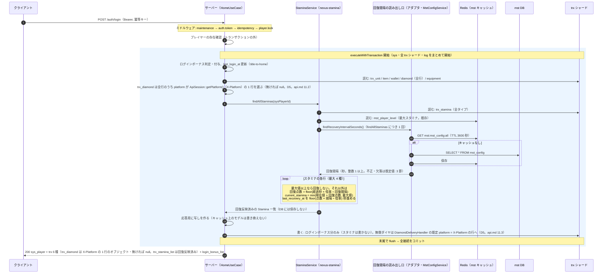
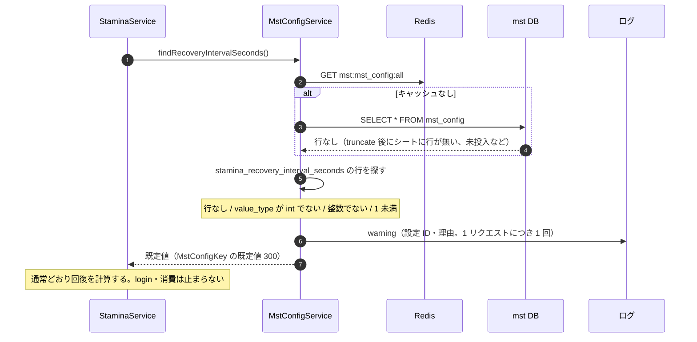
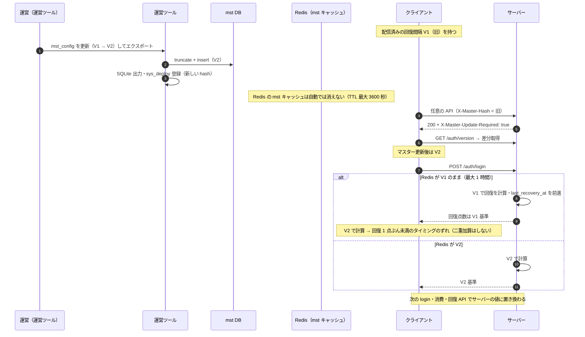
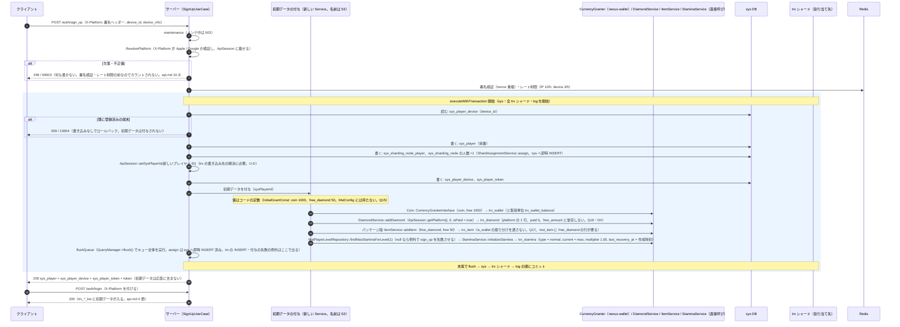
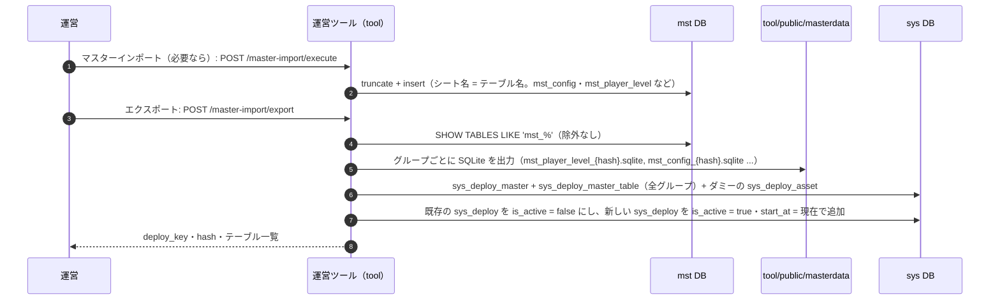

# ホーム＋プレイヤー情報 シーケンス設計（S2）

機能 `home-player-info` のサーバーの通信シーケンス。対象は (1) login でのスタミナ回復と MstConfig の読み出し、(2) MstConfig に値が無いとき、(3) マスター更新の前後で値が違うとき、(4) サインアップ時の初期データ（Q9。人の追加依頼）、(5) マスターのデプロイ（U1）。

- DB: [db.md](db.md)、API: [api.md](api.md)
- login・sign_up・sign_in の基本の流れ: [title-to-home の sequence.md](../title-to-home/sequence.md)（複製せず、差分だけ書く）
- 「読んだ」= コードを読んだだけ。実行で確かめていない部分は各節に書く。

## 1. 正常系: login でスタミナの回復を適用して返す

login の流れは title-to-home のとおり。ここは**スタミナ回復の部分と MstConfig の読み出し**だけを書く。

- **D5（2026-11-14）**: login のダイヤは `trx_diamond_list`（配列）ではなく `trx_diamond`（`X-Platform` の 1 行）を返す。ログインボーナスの無償ダイヤの付与先も、従来の `Apple` 固定から `X-Platform` の行に変わる。付与の既定 platform は、`DiamondDeliveryHandler` が `DefaultPlatformProviderInterface`（API 側の実装が `ApiSession::hasPlatform()` を見て、無ければ `null` → `Apple` にフォールバック）から得る。HTTP 以外の経路（ジョブ・CLI）は `Apple`。api.md 11 節。無償ダイヤの最終形は `trx_item` の `free_diamond`（platform 共通）で、移行前に別 platform の `free_amount` に残る分が見えないのは暫定（D6）。
- MstConfig の読み出しは、スタミナの行の数に関わらず**回復間隔の読み出しは `findAllStaminas` につき 1 回**（行ごとに読み直さない）。テーブルは Redis に 1 キーで持つので、リクエスト内の実際の読み出しは Redis の GET が 1 回以下で、ミス時だけ mst DB に SELECT が 1 回（db.md 2 節の 4）。
- mst は読み取りなので、トランザクションの対象外（mst の接続は `executeWithTransaction` が開始する接続に含まれない。読んだ）。
- 同じ回復間隔が、消費（`consumeStamina`）・回復アイテム（`recoverStaminaByItem`）・満タンまでの時間・レベルアップのリスナーでも使われる。これらは書き込みを伴い、**回復を反映した値を保存する**（db.md 2 節）。値の出どころはすべて同じ読み出し口。

### トランザクション境界（login）

| 範囲 | 内容 |
| --- | --- |
| トランザクションの外 | プレイヤーの存在確認、MstConfig・`mst_player_level` の読み出し（mst は読み取りで、トランザクションに入らない。キャッシュ越し） |
| トランザクションの中 | ログインボーナスの付与、`last_login_at` の更新、trx の読み取り、スタミナの回復計算（保存しない）、応答の組み立て |
| コミット | 末尾で 1 回（sys・全 trx シャード・log）。スタミナ回復は保存しないので、本機能で login の書き込みは増えない |

## 2. 異常系: MstConfig に値が無い（P5）

「無い」= 行が無い、`value_type` が `int` でない、値が整数に解釈できない、1 未満。

- 例外にしない。login のエラーコードは増えない（api.md 7 節）。
- 既定値の置き場所は `MstConfigKey` の 1 か所だけ（db.md 3.3）。
- 欠落中に消費・回復アイテム・レベルアップが走ると、既定値で計算した値が保存される。設定値が既定値（300）のままなら一致する。設定値を変えた後に行が消えたときだけ食い違う（db.md 4 節。警告ログで気づく）。
- Redis が使えないとき（`Cache::store('redis')` が例外）は、login はプレイヤーロックの時点で 503(50300) になる（title-to-home）ので、この節の対象外。ロックを使わない経路（`/player/me` など）は回復を計算しない。

## 3. 異常系: マスター更新の前後で値が違う（U5）

- サーバーは**計算の時点の自分の `mst_config`（キャッシュ込み）**を使い、クライアントの値は受け取らない。ずれは表示だけで、保存される値の正はサーバー。
- 「常に最新」ではない: 運営ツールの反映後、サーバーの Redis が古い間は旧値で計算する（db.md 5 節。キャッシュを消す運用は未解決点 U-B）。
- 変更の運用は通常しない（overview の仮置き U5）。変えるときは、キャッシュの更新を忘れない（db.md 5 節の手順）。

## 4. サインアップ時の初期データ（Q9・Q15〜Q19 は 2026-11-14 に決定。platform は Q16）

現行の sign_up は sys だけに書く（title-to-home の sequence.md 1 節）。**同じ `executeWithTransaction` の中に trx の書き込みを足す。** 全ゲーム API 共通の `X-Platform` ヘッダーの検証（`ResolvePlatform`）が、`maintenance` の後・署名検証の前に入る（api.md 10 節）。

- **platform の出どころ**: ミドルウェアが `ApiSession` に載せた値（api.md 10.4）。sign_up の入力（`device_info.os`）は使わない。
- **platform ヘッダーの検証は `POST /auth/version` にも掛かる**（認証済みの POST は `maintenance` のグループ内。除外は `GET /auth/version` だけ。api.md 10.2）。
- **無償ダイヤ 50 は消費できない暫定**: `trx_item` の `free_diamond` は、`DiamondService::consumeDiamond`（`trx_diamond` だけを見る）から見えない。別機能の完了まで、表示だけ（db.md 8.6 節）。

### トランザクション境界・失敗時

| 事象 | 結果 |
| --- | --- |
| 端末が既に登録済み | 10004。書き込みなしでロールバック。初期データは付与されない（二重付与なし） |
| 付与の途中で例外（Coin・ダイヤ・アイテム・スタミナの直接呼びが投げる。**level 1 の `mst_player_level` が無いときも例外**） | 例外は `executeWithTransaction` まで届き、全接続をロールバック。`sys_player` を含め何も残らない。HTTP ステータスは `_BaseController::determineStatusCode` による: 例外の `getCode()` が 100〜599 ならその値、0 や文字列は 500（読んだ。未確認: 実行）。テストは「200 でないこと」の検査に留める。クライアントは sign_up をやり直せる（device_id の行が残らないため。端末ごとのレート制限 1 時間 3 回に数えられる）。level 1 のマスターが無い（配信前・未投入）ときは、既定値を使わず sign_up を失敗させ、デプロイの不備として検出する |
| （採らない案）付与を `ResourceDeliveryService` で行う | `execDeliveryIteration` が例外を `catch (\Throwable)` でログに出すだけで続行する（読んだ）ので、**付与が失敗しても sign_up は 200 で成功し、初期データの無いプレイヤーが残る**。このため直接呼びを採る |
| flush 中に trx への INSERT が失敗 | `executeWithTransaction` が全接続をロールバック。何も残らない |
| コミットの途中で失敗（`sys` のコミット後に trx のコミットが失敗） | **窓が残る**: プレイヤーと端末は登録済みだが初期データが無い。2PC ではなく、接続を順にコミットする既存の性質。再 sign_up は 10004、sign_in は成功するので、`trx_*_list` が空のプレイヤーになる。許容する（Q18 の login 補填案を採らない場合）。発生頻度は低い想定で、頻度は未確認 |
| 同じ `device_id` の同時 sign_up | 既存の未解決点（title-to-home の api.md 12 節）。初期データの付与は各プレイヤーに 1 回ずつで、これで悪化はしない |

- **sign_up の冪等**: sign_up は冪等ミドルウェアの対象外（未認証）。再送は 2 回目が 10004 になるだけで、初期データは 1 回だけ。クライアントは 10004 を受けたら sign_in に切り替える（title-to-home の方針）。
- **sign_in → sign_up の切り替え**（sign_in が 10002 を返し、クライアントが sign_up する流れ。title-to-home 3 節）: sign_in は何も書かないので初期データに影響しない。sign_up は上の図のとおり。
- **レート制限**: sign_up は IP 10/h・device 3/h（title-to-home）。初期データを足しても変わらない。429 のとき署名の検証後なので、初期データは書かれない。
- **TiDB モード**（`TidbMode::isEnabled()`）では `assign` を呼ばず、trx の接続は `trx1` 固定。付与は同じ呼び出しで `trx1` に入る見込み（未確認）。
- **書き込み先のシャード**: 割り当て（`assign`）が `sys_sharding_node_player` に書いた行を、同じトランザクションの `sys` 接続で読んで trx の接続名を決める。Redis のシャードキャッシュ（`shard:player:{id}`）は未設定のためミスして DB を引く（読んだ。実行はしていない）。
- **ログ**: 付与は `log_*`（PITR 変更ログ・ウォレットの履歴など）を同じトランザクションで書く（既存の付与経路の性質。読んだ）。

## 5. マスターのデプロイ（U1。運用の手順）

- 開発環境は現在、`sys_deploy_master_table` が 0 行・配信ファイルなし（api.md 6.2）。この手順（エクスポート）で配信される。サーバーのコード変更は要らない。
- 同じ内容（ハッシュ）が登録済みなら新規には作らず、既存の deploy_key を返す。`mst_config` を足すとグループが 1 つ増えるので、マニフェストのハッシュが変わり、新しいデプロイになる。
- エクスポートは**サーバーの mst の Redis キャッシュを消さない**（db.md 5 節）。

## 6. 未解決点

| # | 内容 |
| --- | --- |
| U-B | 運営ツールの反映後、サーバーの mst キャッシュ（Redis）をどう更新するか。人の判断（db.md 5 節） |
| U-D | sign_up での `ApiSession::setSysPlayerId` の呼び出しと、trx の書き込み先の解決を、S3 で実行して確かめる（4 節。読んだだけ）。`assign` は sys へ即時 INSERT なので同じ接続で読めるはずだが、`flushQueue()` との順序は実行で確認 |
| 実行未確認 | 4 節の「付与の途中で例外」時の HTTP ステータス、コミットの途中で失敗する頻度。1〜2 節の図は、コードを読んで書いたもので、実行ログではない |
| 確認事項 | なし。Q8・Q15〜Q26・D4・D5・D6・D7 は決定済み（[db.md 8.3・8.4 節](db.md)、[api.md 9・10・11 節](api.md)）。D5 の確認事項は api.md の U-7・U-9。旧版クライアントは未配布で互換不要（D7。Q22 の配布状況の確認は解消済み） |
