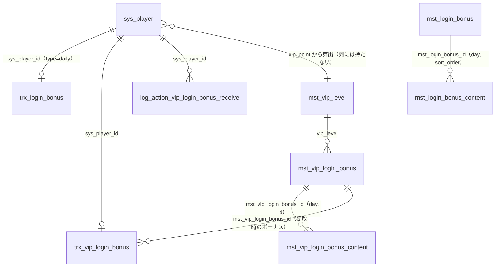

# ログインボーナスのカレンダー表示とアイテムアイコン DB 設計（S2）

機能 `login-bonus-calendar` のサーバー側 DB 設計。**結論は「スキーマの変更なし」**（1 節）。この文書は、変更なしの根拠、新しい読み方・書き方に要る Repository の変更、並びの固定、録画用シードの設計を書く。

- 要件: `Nexus/docs/requirements/login-bonus-calendar.md`（**仕様の正本**。T / C / K / D / I / H / R / Q の節記号で指す。仕様はここに写さない）
- 全体設計: `Nexus/docs/design/login-bonus-calendar/overview.md`（マージ済み。U-1〜U-10 は [api.md](api.md) 9 節で答える）
- API: [api.md](api.md)、シーケンス: [sequence.md](sequence.md)
- DB 全般の規約: `.claude/database.md`
- 凡例: 「読んだ」= コードを読んだだけ。「未確認」= 読めていない。実行（`make migrate`・seed・テスト）はしていない。サーバーは main `7cf4ddcb` 時点。

## 1. 結論

| 項目 | 内容 |
| --- | --- |
| スキーマ | **変更なし**。テーブル・列・索引・マイグレーションを足さない・変えない |
| 変更なしの根拠 | 下の 2 節 |
| mst の string id 規約 | 新しい mst テーブルを作らないので `MstRequiresStringIdTest` / `MstNoAutoIncrementIdTest` に新しく触れない。ただし `mst_login_bonus_content`・`mst_vip_login_bonus_content` は既に解消待ち（`PENDING_VIOLATIONS`）で、**この機能はその一覧を増やしも減らしもしない**（3 節に、並びの固定がその解消に影響する点を書く） |
| `mst_item` のアイコン | **サーバー側に要るものは無い**（4 節） |
| Repository | 並びを固定する変更と、全日の報酬を 1 クエリで取る読み取りの追加（3 節）。DB へは書かない |
| シャード・マイグレーション方針 | 変更なしなので該当しない。新しい読み取りは既存の trx シャード（`ApiSession` が解決）を使う |
| ER 図 | 5 節（既存テーブルの関係だけ。変更なし） |
| 録画用シード | 6 節（`Recording/` に足す。マイグレーションではない） |

## 2. スキーマを変えない根拠（読んだ）

| 要るもの | 既にある場所 | 確かめた内容 |
| --- | --- | --- |
| 通常の進捗（最後に配った日数・受取日） | `trx_login_bonus`（主キー `(sys_player_id, type)`。`type = daily` の 1 行。`day`・`received_date`・`mst_login_bonus_id`） | `packages/nexus-login/database/migrations/trx/...create_login_tables.php`。`TrxLoginBonusRepository::selectByType` が `queryOrMemory()` で読む |
| VIP の進捗 | `trx_vip_login_bonus`（主キー `sys_player_id`。`mst_vip_login_bonus_id`・`day`・`vip_level`・`received_at`） | `packages/nexus-vip/database/migrations/trx/...create_vip_tables.php` |
| **受取時の VIP レベル（R4 ②）** | `trx_vip_login_bonus.vip_level`（`unsignedTinyInteger`、**not null**。コメント「受け取り時のVIPレベル」） | 列は create マイグレーション当初から定義済み。配るたびに `VipLoginBonusService::recordHistory` → `upsertLatest` が `bonusData['current_vip_level']` で上書きする。したがって**既存行にも値が入っている**（null になる経路が無い）。マイグレーション・既存データの移行は不要 |
| 全日の報酬（通常） | `mst_login_bonus_content`（`mst_login_bonus_id`・`day`・`content_*`・`sort_order`） | `sort_order` あり。`day = 0` はカムバック用で、通常の `day` は 1〜`loop_days` |
| 全日の報酬（VIP） | `mst_vip_login_bonus_content`（`id`（連番）・`mst_vip_login_bonus_id`・`day`・`content_*`）。索引 `idx_vip_login_bonus_day (mst_vip_login_bonus_id, day)` | **`sort_order` 列は無い**。並びは `id` で固定する（3 節） |
| VIP ボーナス本体 | `mst_vip_login_bonus`（`id` string。`vip_level`・`loop_days`・`is_active`・`start_at`・`end_at`） | `id` は人が決める安定値（例 `vip_login_lv5`）。再受け取りの API のパラメータにできる |
| 受取履歴（R3） | `log_action_vip_login_bonus_receive`（1 報酬 1 行。`vip_level`・`day`・`received_at`・`reward_*`） | 再受け取りも同じ表に足す。**再受け取りを区別する列は足さない**（7 節の注） |
| 「今日」の判定 | 追加の列は要らない | `ClockUtility::isSameGameDay(今, 受取日)`（[api.md](api.md) 4 節） |

## 3. Repository の変更（スキーマではなく読み方）

どれも DB へ書かない。`api/app/Repositories/Mst/` と、パッケージ契約 `packages/nexus-login` の `LoginBonusRepositoryInterface`。

| 変更 | 場所 | 内容・理由 |
| --- | --- | --- |
| VIP の報酬の並びを固定 | `MstVipLoginBonusRepository::selectContentsByBonusIdAndDay` | 現状は並びの指定なし（読んだ）。`orderBy('id')` を足す。**配るとき（`login_bonus_list` の VIP 分と応答の `updated_resources` の順）と、カレンダーの 1 日の中の順を同じにする**ための変更（overview 7 節の e）。InnoDB の二次索引は末尾に主キーを持つので、今も多くの場合 `id` 順になると推測するが、明示して保証する。既存テストへの影響は api.md 8 節 |
| VIP の全日の報酬の取得 | `VipLoginBonusRepositoryInterface` に `selectContentsByBonusId(string $mstVipLoginBonusId): CustomCollection` を追加 | `orderBy('day')->orderBy('id')`。全日を **1 クエリ**で取る（overview 8 節の宿題 9）。`toArray()` した連想配列（既存の `selectContentsByBonusIdAndDay` と同じ形） |
| 通常の全日の報酬の取得 | `LoginBonusRepositoryInterface`（package）に `selectDailyContentsByLoginBonusId(string $mstLoginBonusId): array` を追加し、`LoginBonusRepositoryAdapter` が実装 | `where('day', '>=', 1)`、`orderBy('day')->orderBy('sort_order')->orderBy('content_type')->orderBy('content_mst_id')`。**既存の `selectContentsByLoginBonusId`（`sort_order` だけで並べる。日をまたぐ）は変えない**（テストが固定している。読んだ） |
| 通常の 1 日の報酬の並びの固定 | `LoginBonusRepositoryAdapter::selectContentsByLoginBonusIdAndDay` | `orderBy('sort_order')` の後ろに `content_type`・`content_mst_id` を足す。`sort_order` が同値の行の並びを DB 任せにしないため。主キー `(mst_login_bonus_id, day, content_type, content_mst_id)` で全順序になる。配る順とカレンダーの順が同じになる |
| 今のレベルの VIP ボーナスの引き方を固定 | `MstVipLoginBonusRepository::selectActiveByVipLevel` | `->first()` の前に `orderBy('id')`。同じレベルに有効な行が 2 件以上あるマスターの誤りがあっても、配布・カレンダー・再受け取りが**同じ 1 件**を選ぶ（現状は未指定。読んだ） |
| `convertToResource` の公開 | `packages/nexus-login` | 行 → `LoginBonusContent` → `Resource` の変換を、状態を持たない `NexusLogin\Services\LoginBonusResourceConverter` に切り出す。`_BaseLoginBonusService` の `toContents` / `convertToResource` はこれに委譲する（動作は変えない）。**2 通りの変換を作らない**（U-2。[api.md](api.md) 9 節） |

**mst の string id 規約との関係（注意）**: `mst_vip_login_bonus_content.id` は今は連番（AUTO_INCREMENT。`PENDING_VIOLATIONS` の解消待ち）。上の `orderBy('id')` は連番を前提にした「登録順」。**解消時に `id` が `親ID:content_type:content_mst_id` のような文字列になると、`orderBy('id')` は辞書順に変わり、配る順が変わる**。そのときは `sort_order` 列を足して並びの鍵を移す必要がある。この機能で今 `sort_order` を足さないのは、overview 6 節の決定（マスターのテーブル・列を変えない）に従うため。**U-S2-2** に残す（[api.md](api.md) 9 節）。

## 4. `mst_item` のアイコン（I1〜I12）

**サーバー側に要るものは無い**（スキーマ・マスターの中身・応答・配信ファイルのどれも変えない）。

| 確かめたこと | 結果 |
| --- | --- |
| `mst_item` に絵の列を足すか | 足さない（overview 6 節。アイコンは `assets/icons/items/<mst_item.id>.svg` の ID 規約でクライアントが引く） |
| マスター配信（`mst_item` の SQLite） | 列が増えないのでハッシュも形も変わらない。クライアントの `master_data` の読み取りも変わらない |
| 応答に絵の指定を載せるか | 載せない。新キーの報酬の要素は `type`・`id`・`amount`・`metadata` だけ（[api.md](api.md) 3 節）。絵は `type` と `id` からクライアントが決める |
| `mst_item` の行が増えたとき | サーバーは関与しない。クライアントが同名の SVG を足す（足し忘れはフォールバックで出る。I6） |
| 現行の `mst_item` の行（`MstItemSeeder`） | 29 行・`type` 9 種は overview 6 節の見積りのとおり（サーバー側では**読んでいない**。見積りは overview に従う。未確認） |

## 5. ER 図（既存のまま。この機能が読む・書く範囲）

| 接続 | テーブル | この機能での読み書き |
| --- | --- | --- |
| mst | `mst_login_bonus`・`mst_login_bonus_content`・`mst_vip_login_bonus`・`mst_vip_login_bonus_content`・`mst_vip_level` | 読むだけ |
| sys | `sys_player` | 読むだけ（`vip_point`・`last_login_at`。再受け取りは更新しない） |
| trx（シャード） | `trx_login_bonus` | 読むだけ（login の配布は既存どおり書く） |
| trx（シャード） | `trx_vip_login_bonus` | 読む。**`POST /login_bonus/receive` が更新する**（`mst_vip_login_bonus_id`・`vip_level`・`received_at`。`day` は据え置き） |
| trx（シャード） | 報酬の反映先（`trx_item`・`trx_wallet`・`trx_unit` など） | 再受け取りが `ResourceDeliveryService` 経由で更新 |
| log（trx と同じシャード） | `log_action_vip_login_bonus_receive` | 再受け取りが 1 報酬 1 行を追加 |

## 6. 録画用シードの設計（Q16・U-7。overview 8 節の宿題 8）

マイグレーションではなく `api/database/seeders/Recording/`。規約は `Recording/README.md`（追加専用・冪等・マーカー）に従う。

**課題**: 今の `Recording/` は mst と sys のマスター系だけを触る（`RecordingLoginBonusSeeder` は `daily_login` を有効にするだけ。読んだ）。**「N 日目まで受け取り済み」は特定のプレイヤーの trx と `sys_player.last_login_at` を書き換えないと作れない**。trx にはマーカー列が無いので、README の「マーカー行だけを作る・消す」はそのままでは当てはまらない。

| 既定案（仮置き） | 内容 |
| --- | --- |
| 対象の指定 | 環境変数 `RECORDING_PLAYER_MY_ID`（`sys_player.my_id`）で 1 人を指す。無ければシナリオは何もせず警告を表示して終わる（誤って他のプレイヤーを書き換えないため）。`production` は既存の `RecordingScenarioSeeder::run()` の環境ガードで止まる |
| 置き場 | `Scenarios/RecordingLoginBonusProgressSeeder.php`（1 クラスに状態を切り替える定数・引数で 8 シナリオ）または シナリオごとの小さいクラス。**既定の一覧に入れない**（README「既定に入れない理由」。データを書き換えるため） |
| 書くもの | `trx_login_bonus`（`type=daily` の `day`・`received_date`・`mst_login_bonus_id`）、`trx_vip_login_bonus`（`day`・`vip_level`・`received_at`・`mst_vip_login_bonus_id`）、`sys_player.last_login_at`・`sys_player.vip_point`。書き込みは Seeder なので Repository を通さず直接でよい（既存シードと同じ。`NoDirectEloquentWriteTest` の対象外か未確認） |
| 日付の作り方 | 「今日のゲーム日の開始」は `ClockUtility::calcGameDayStart()`、「前日」はその 1 日前。**login で配る前の状態**を作る（①②④⑤ は `last_login_at` を前日にして、login で今日の分が配られる） |
| 戻し方 | `RecordingResetSeeder` に足さない（trx に目印が無い）。対象のプレイヤーを `seed-recording-one` で別の状態へ上書きするか、新規プレイヤーを作り直す。README にその旨を書く |

| # | シナリオ（overview 8 節 ①〜⑧） | 作る状態 | login / 画面で期待する結果 |
| --- | --- | --- | --- |
| ① | 初回（1 日目） | `trx_login_bonus`・`trx_vip_login_bonus` の行なし、`last_login_at = null` | 通常 1 日目・VIP 1 日目が配られる。`is_granted_now` が両段で真 |
| ② | 3 日目まで受け取り済みの翌日 | 通常・VIP とも `day = 3`、受取日・`last_login_at` は前日 | 4 日目が配られる |
| ③ | 同じ日の 2 回目 | ② の後にもう一度 login（または `day = 4`・受取日 = 今日・`last_login_at` = 今日） | `login_bonus_list` は空。`is_granted_today` 真・`is_granted_now` 偽 |
| ④ | 7 日目を配る | `day = 6`、受取日・`last_login_at` は前日 | 7 日目が配られる |
| ⑤ | 1 周後の 1 日目 | `day = 7`、受取日・`last_login_at` は前日 | `day` が 1 に戻る |
| ⑥ | VIP の対象あり（既定）・なし | `MstVipLoginBonusSeeder` は VIP 0〜10 全レベルに 7 日の行がある（読んだ）。なしにするには、対象レベルの `mst_vip_login_bonus.is_active = false` | VIP のキーが `null`（なし）。既定は VIP の段が出る |
| ⑦ | 今日の段でない段 | 通常は受取日 = 今日、VIP は受取日 = 前日（または VIP の行なし）で `last_login_at` = 今日 | 両段とも項目はあるが、VIP は `is_granted_today` 偽 |
| ⑧ | VIP の再受け取り | `trx_vip_login_bonus` を「受取日 = 今日・`vip_level` = 低いレベル・`day` = 据え置く日」にし、`sys_player.vip_point` を足して今のレベルを上げる。今のレベルの VIP マスターに、その日の報酬行があること（`MstVipLoginBonusSeeder` で足りる。読んだ） | login 応答 / `POST /login_bonus/list` で `can_re_receive` 真。`POST /login_bonus/receive` で配られる |

テスト: `api/tests/Feature/Recording/`（`RecordingScenarioTest` の流儀。2 回流して状態が変わらない・`RECORDING_PLAYER_MY_ID` が無いと何もしない・各シナリオ後の `POST /login_bonus/list` の項目）。撮影の手順は README と Nexus の `docs/workflow/recording.md`（後者は Nexus 側）。

## 7. 注意と未確認

- **再受け取りの履歴の識別**: `log_action_vip_login_bonus_receive` に再受け取りを示す列は足さない（overview の決定）。再受け取りの行は、**同じ `(sys_player_id, received_at)` に `vip_level` が異なる行が複数ある**ことで後から見分けられる（1 回目は低いレベル、再受け取りは高いレベル）。集計で見分けたいなら `is_re_receive` 列の追加が要る（design-change。**U-S2-3**）。
- **既存行の `vip_level`**: 上記のとおり not null で必ず入る。ただし、開発・検証の環境で seed が `trx_vip_login_bonus` を直接作っている場合の値は**未確認**（`VipLoginBonusSeederTest` は mst の検査）。S3 で確かめる。
- 実行（マイグレーション・seed・テスト）は一切していない。上の「読んだ」はすべてコードの読み取り。
