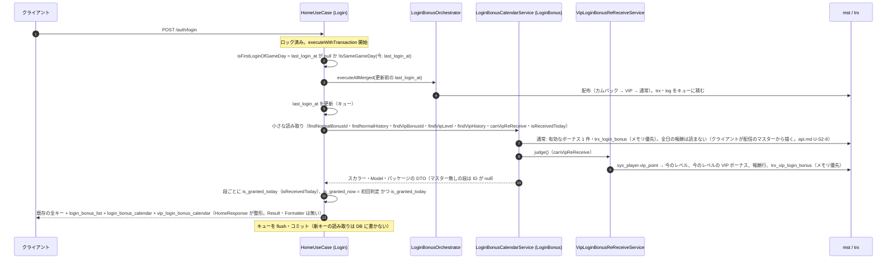
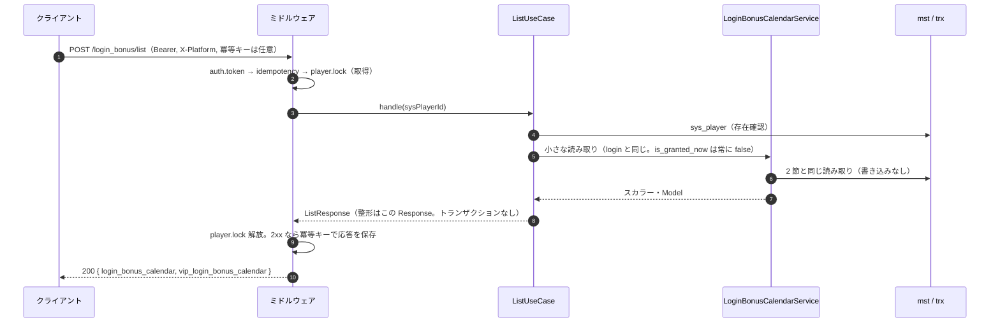
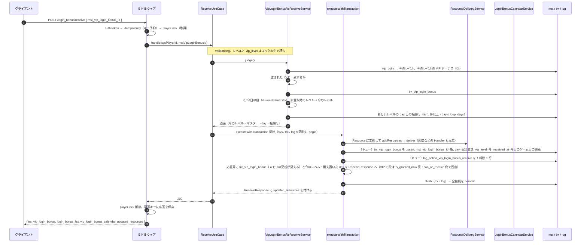
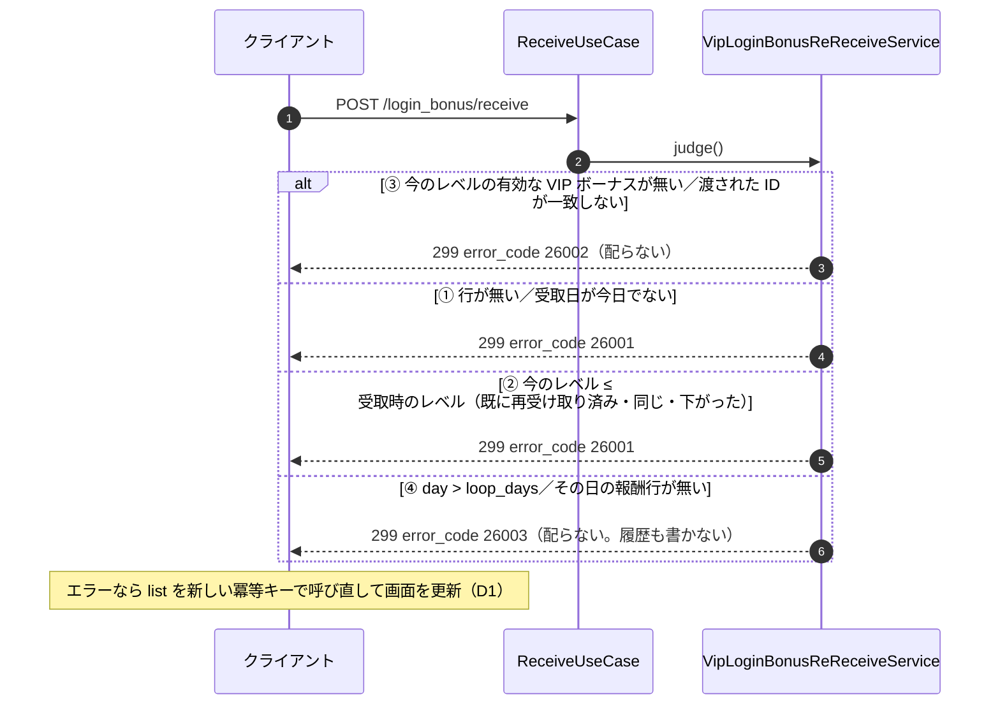
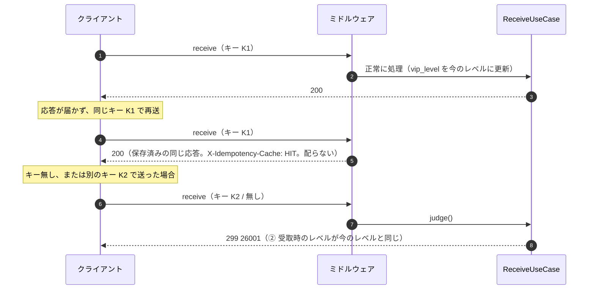
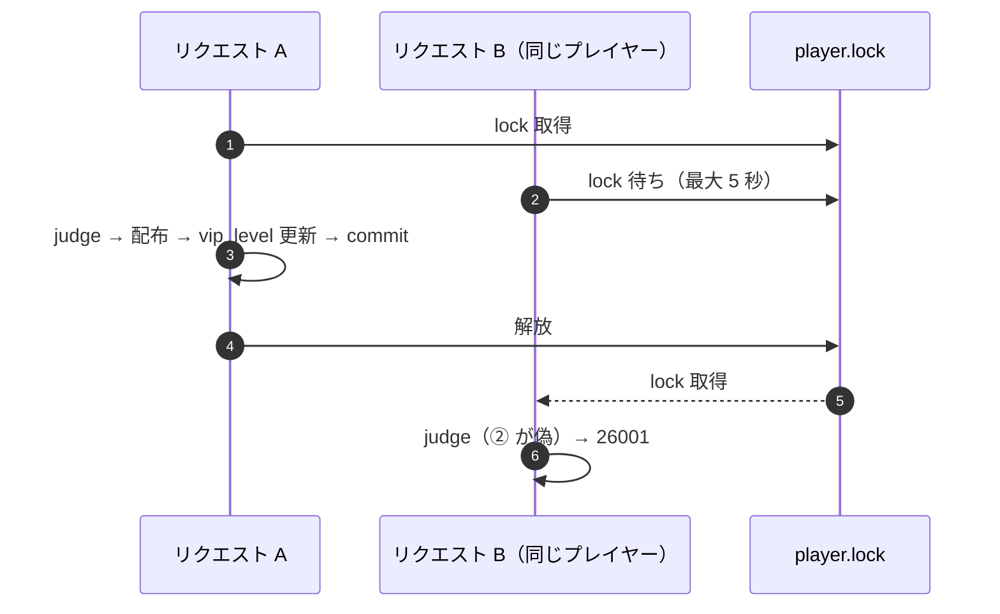
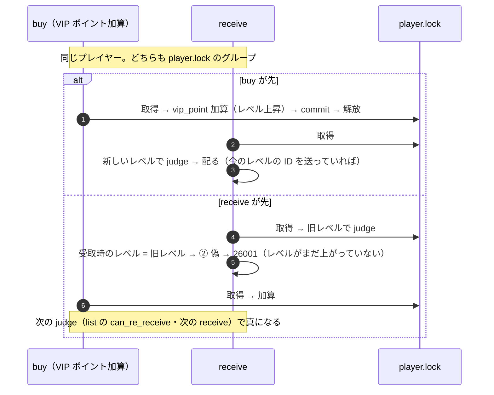

# ログインボーナスのカレンダー表示とアイテムアイコン シーケンス設計（S2）

機能 `login-bonus-calendar` のサーバーの通信シーケンス。対象は (1) login の新キー（自動配布の後に読む）、(2) `POST /login_bonus/list`、(3) `POST /login_bonus/receive`（正常・異常・同時実行）、(4) トランザクション境界。

- 要件: `Nexus/docs/requirements/login-bonus-calendar.md`（**仕様の正本**）、全体設計: `Nexus/docs/design/login-bonus-calendar/overview.md`
- DB: [db.md](db.md)（`sort_desc` 列の追加と、通常側の `sort_order` → `sort_desc` の置き換えのみ）、API: [api.md](api.md)（項目・エラー・クラス名）
- 凡例: 「読んだ」= コードを読んだだけ。実行はしていない。サーバーは main `7cf4ddcb`

## 0. 共通の前提（読んだ）

- 新 API は `maintenance` → `platform` → `auth.token` → `idempotency` → `player.lock` の順（`routes/api.php` の認証後のグループ。`/login_bonus/*` もここに置く）。`player.lock` は GET 以外のリクエストをプレイヤー単位で直列にする（最大 5 秒待ち、取れなければ 409）。
- 書き込みは `executeWithTransaction()` の中で Repository のキューに積み、コミット時にまとめて反映する。`updated_resources` はコミット後に Response へ付く。
- Trx の読み取りは `queryOrMemory()`（同じリクエストで積んだ未保存の更新が見える）。

## 1. login（新キーを自動配布の後に読む）

- **同じ日の 2 回目**: 3 の配布は走らない（両戦略とも `isEligible` が偽）。`isFirstLoginOfGameDay` が偽なので `is_granted_now` は両段とも偽、`is_granted_today` は真。`login_bonus_list` は空。再受け取りが可能（R4 を満たす）なら `can_re_receive` が真。
- **新規プレイヤーの初回 login**: `last_login_at` が null → 初回扱い。配布後の読み取りで `last_received_day = 1`・`is_granted_today` 真・`is_granted_now` 真。
- **マスターが無い**: 該当の段のキーの値が `null`（login は成功する）。
- **不正な行**（未知の `content_type`）: カレンダーには報酬を載せないので除く処理は無い（api.md U-S2-8）。**その日が配布の日なら配布が失敗する**（既存どおり。`ValueError` で login 全体が失敗しうる。変えない）。
- 配布前に読むと `last_received_day` が古くなるので、**読むのは配布と `last_login_at` 更新の後**（順序の保証はテストで固定: 初回 login の応答で `last_received_day = 1`）。

## 2. `POST /login_bonus/list`（副作用なし）

- **トランザクションを張らない**。書き込みが無いので `updated_resources` も無い（H2a）。
- プレイヤーロックの対象なので、再受け取り・課金・login が実行中なら**それが終わるまで待ち**、その後の最新の状態を返す（最大 5 秒。取れなければ 409 / 40900。クライアントは 0.5〜1 秒あけて再送。`docs/player_request_lock.md`）。
- **冪等キーを使い回さない**: 同じキーの再送は、保存済みの応答（古い状態）をそのまま返す（`X-Idempotency-Cache: HIT`）。

## 3. `POST /login_bonus/receive`

### 3.1 正常

**トランザクション境界**: 判定（`judge`）は**トランザクションの前**（`validation()`。ただしプレイヤーロックの中なので、他のリクエストに割り込まれない）。**配布・`trx_vip_login_bonus` の更新・`log` の追加・応答用の再計算は 1 つのトランザクション**（sys・trx・log を同時に開始し、同時にコミット。途中で失敗すれば全部巻き戻り、`updated_resources` も捨てる）。`vip_level` の更新が配布と同じトランザクションなので、**配ったのに `vip_level` が古いまま**（次の呼び出しで再び配られる）状態は作らない。

### 3.2 異常系

- **どのエラーでも DB は変わらない**（`executeWithTransaction` に入る前に例外。キューも空）。
- **422**: `mst_vip_login_bonus_id` が無い・文字列でない・65 文字以上（FormRequest。UseCase に入らない）。
- **401**: トークン不正（`auth.token`）。**409 / 40900**: ロックが取れない、または同じ冪等キーが処理中。**503 / 50300**: ロックの置き場に繋がらない。**503（メンテ）**: `maintenance`。いずれも既存どおり。
- **299 の冪等**: 業務エラー（HTTP 299）も冪等ミドルウェアは 2xx として保存する（読んだ。api.md U-S2-1）。同じキーでの再送は同じエラーを返すので、クライアントは再送に新しいキーを付ける。

### 3.3 二重送信・再送

### 3.4 同時実行（同時の 2 リクエスト）

- B は A の**コミット後**に判定する（`player.lock` が直列にする。同じ冪等キーなら B は 409 / 40900）。5 秒待っても取れなければ 409 で、クライアントが再送する。

### 3.5 課金（`in_app_purchase/buy`）との直列

- レベルと `trx_vip_login_bonus.vip_level` は**ロックを取った後**に読む（`judge` は `handle` の中。ミドルウェアが先にロックする）。
- 課金が先で、クライアントが古い `mst_vip_login_bonus_id`（旧レベルの ID）を送った場合は **26002**（今のレベルの ID と一致しない）。クライアントは `list` で取り直す。

## 4. トランザクション境界の一覧

| API | トランザクション | 範囲 |
| --- | --- | --- |
| `POST /auth/login` | あり（既存。`HomeUseCase`） | 配布・`last_login_at` 更新に加え、**新キーの読み取りも同じトランザクションの中**で行う（メモリ上の更新を読むため）。新キーの読み取り自体は DB に書かない |
| `POST /login_bonus/list` | **なし** | 読み取りのみ |
| `POST /login_bonus/receive` | あり | 配布・`trx_vip_login_bonus`・`log_action_vip_login_bonus_receive`・応答用の再計算。判定は前（ロックの中） |

## 5. 未確認・S3 で確かめること

- 新キーを login のトランザクションの**中**で読むときの追加クエリ数（見積り。VIP の `mst_vip_login_bonus` の読み取りは `judge()` の結果を使い回して 1 回にした。list の mst クエリでテストが固定）。
- Architecture の検査（`ResponsePerActionTest`・`UpdatedResourcesResponseTest`・`ModuleBoundaryTest`。命名の `ResponseKeyNamingTest`・`ConverterLocationTest` も）が新クラスで通るか。実行していないので、S3 の確認項目（api.md 10 節）。
- `received_at` の応答の書式（実測して確定。api.md 8 節）。
- `updateLastLoginAt` の呼び出し元が `HomeUseCase` だけか（api.md 4 節の不変条件）。
- 同じプレイヤーの `list` と `receive` を並べたときの 409 の頻度（ホームから開くたびに呼ぶので、`docs/player_request_lock.md` の負荷試験の観点に足す）。
