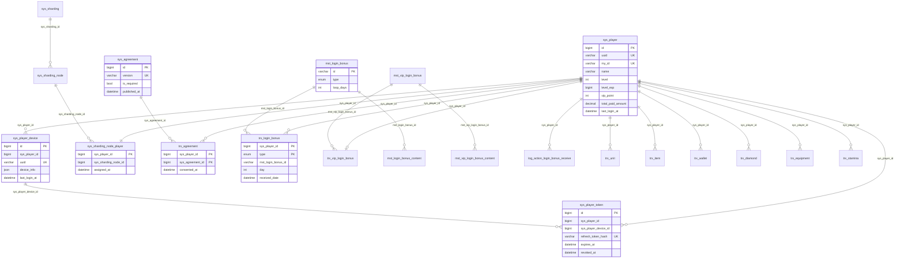

# タイトル〜ホーム DB 設計

既に実装済みの機能の設計書。**実装（マイグレーション・Model・Repository）が正**で、ここにはコードから確かめた事実だけを書く。確かめられなかったものは「未確認」と書き、末尾の「未解決点」に集める。

- 全体設計: `Nexus/docs/design/title-to-home/overview.md`（Nexus リポジトリ）
- API: [api.md](api.md)、シーケンス: [sequence.md](sequence.md)
- DB 全般の規約: `.claude/database.md`

## 1. 対象テーブルと接続

| 区分 | テーブル | 接続 | 主な用途 |
| --- | --- | --- | --- |
| 認証 | `sys_player` | sys | プレイヤー本体（採番元） |
| 認証 | `sys_player_device` | sys | 端末（`device_id` = `uuid`） |
| 認証 | `sys_player_token` | sys | リフレッシュトークン（SHA-256 ハッシュ） |
| シャード | `sys_sharding` / `sys_sharding_node` / `sys_sharding_node_player` | sys | プレイヤーの trx シャード割当 |
| 規約 | `sys_agreement` | sys | 規約の版（全プレイヤー共通） |
| 規約 | `trx_agreement` | trx（プレイヤーのシャード） | 同意記録 |
| ログインボーナス | `mst_login_bonus` / `mst_login_bonus_content` | mst | 通常・カムバックの設定と報酬 |
| ログインボーナス（VIP） | `mst_vip_login_bonus` / `mst_vip_login_bonus_content` | mst | VIP の設定と報酬 |
| ログインボーナス | `trx_login_bonus` | trx | 通常・カムバックの最新受取状態 |
| ログインボーナス（VIP） | `trx_vip_login_bonus` | trx | VIP の最新受取状態 |
| 所持データ | `trx_unit` `trx_item` `trx_wallet` `trx_diamond` `trx_equipment` `trx_stamina` | trx | login で全量を返す |
| ログ | `log_action_login_bonus_receive` / `log_action_vip_login_bonus_receive` | trx と同じ DB（接続は trxN） | 受取履歴 |
| 配信管理（version が読む） | `sys_deploy` / `sys_deploy_master` / `sys_deploy_master_table` / `sys_deploy_asset` / `sys_maintenance` | sys | マスター配信・メンテナンス情報 |

接続の考え方は `.claude/database.md` の 1 節のとおり。`trx_*` と `log_*` は同じシャード DB（`trx1`..`trxN`）に入り、log 専用の DB は無い。trx / log の Model は `$connection` を持たず、`ApiSession` が解決したシャードに振り分ける。

### 規約との差（実装の事実）

規約（`.claude/database.md`）と異なる実装がある。変更はしない。

| 規約 | 実装 |
| --- | --- |
| sys / trx / log に ENUM を使わない | `sys_sharding.strategy`・`sys_sharding_node.status`・`sys_deploy_master.status`・`sys_deploy_asset.status`、`trx_login_bonus.type`、`log_action_login_bonus_receive.type` が ENUM |
| 外部キー制約を張らない | `mst_login_bonus_content` と `mst_vip_login_bonus_content` に FK（`onDelete cascade`） |
| 日時は `dateTime`、`timestamps()` を使わない | `mst_vip_login_bonus` の `start_at` / `end_at`、`mst_vip_login_bonus_content` の `timestamps()` は `timestamp` 型 |
| mst の全テーブルに `deploy_key` | `mst_vip_login_bonus` / `mst_vip_login_bonus_content` には無い（`mst_login_bonus*` にはある） |
| log に `system_at` と `unique_request_id` | `log_action_login_bonus_receive` / `log_action_vip_login_bonus_receive` には無い（`received_at` と `created_at` のみ） |

## 2. マイグレーションの場所

| テーブル | ファイル（`NexusLaravelMobileGameServer/` 起点） |
| --- | --- |
| `sys_player` `sys_player_device` `sys_sharding` `sys_sharding_node` `sys_sharding_node_player` | `packages/nexus-core/database/migrations/sys/2026_01_01_000001_create_core_tables.php` |
| `sys_player_token`（ほか `sys_player_transfer_code` `sys_player_external_account`） | `packages/nexus-core-auth/database/migrations/sys/2026_01_01_000001_create_auth_tables.php` |
| `sys_agreement` | `packages/nexus-agreement/database/migrations/sys/2026_01_01_000001_create_agreement_tables.php` |
| `trx_agreement` | `packages/nexus-agreement/database/migrations/trx/2026_01_01_000001_create_agreement_tables.php` |
| `mst_login_bonus` `mst_login_bonus_content` | `packages/nexus-login/database/migrations/mst/2026_01_01_000001_create_login_tables.php` |
| `trx_login_bonus` | `packages/nexus-login/database/migrations/trx/2026_01_01_000001_create_login_tables.php` |
| `log_action_login_bonus_receive` | `packages/nexus-login/database/migrations/log/2026_01_01_000001_create_login_log_tables.php` |
| `mst_vip_*` | `packages/nexus-vip/database/migrations/mst/2026_01_01_000001_create_vip_tables.php` |
| `trx_vip_login_bonus` | `packages/nexus-vip/database/migrations/trx/2026_01_01_000001_create_vip_tables.php` |
| `log_action_vip_login_bonus_receive`（ほか `log_action_vip_point_change`） | `packages/nexus-vip/database/migrations/log/2026_01_01_000001_create_vip_log_tables.php` |
| `trx_unit` `trx_item` `trx_equipment` | `packages/nexus-core/database/migrations/trx/2026_01_01_000001_create_resource_tables.php` |
| `trx_player` | `packages/nexus-core/database/migrations/trx/2026_01_01_000001_create_core_tables.php` |
| `trx_wallet` `trx_wallet_balance` | `packages/nexus-wallet/database/migrations/trx/2026_01_01_000001_create_wallet_tables.php` |
| `trx_diamond` `trx_diamond_balance` | `packages/nexus-core-billing/database/migrations/trx/2026_01_01_000001_create_billing_tables.php` |
| `trx_stamina` | `packages/nexus-stamina/database/migrations/trx/2026_01_01_000001_create_stamina_tables.php` |
| `sys_deploy*` | `packages/nexus-version/database/migrations/sys/2026_01_01_000001_create_version_tables.php` |
| `sys_maintenance` | `packages/nexus-maintenance/database/migrations/sys/2026_01_01_000001_create_maintenance_tables.php` |

`log_action_login_bonus_receive` は `api/database/migrations/log/` ではなく nexus-login パッケージ側にある。

## 3. 認証・プレイヤー（sys）

### sys_player

主キー `id`（BIGINT UNSIGNED、`sys_player_id` として他テーブルが参照する採番元）。

| カラム | 型 | null | 既定 | 索引 | 説明 |
| --- | --- | --- | --- | --- | --- |
| id | bigint unsigned | 不可 | auto | PK | プレイヤー ID |
| uuid | varchar(64) | 不可 | - | unique | 内部識別子（UUIDv4）。API には返さない |
| my_id | varchar(8) | 不可 | - | unique | フレンド検索・問い合わせ用の 8 文字 |
| name | varchar(100) | 可 | NULL | - | sign_up 時に**ランダム 8 文字**を入れる（null にはならない） |
| level | int unsigned | 不可 | 1 | index | |
| level_exp | bigint unsigned | 不可 | 0 | - | |
| vip_point | int unsigned | 不可 | 0 | index | VIP レベルの算出元 |
| total_paid_amount | decimal(15,2) | 不可 | 0.00 | - | 累積課金額（円） |
| last_login_at | dateTime | 可 | NULL | index | **login が更新する**（sign_in は更新しない）。UTC |
| created_at / updated_at | dateTime | 不可 | CURRENT_TIMESTAMP（updated は ON UPDATE） | - | API には返さない |

`uuid` / `my_id` には unique に加えて同じ列の通常 index も重ねている（重複索引。実装の事実）。

- 書き込み: sign_up が INSERT（`my_id` `uuid` `name` のみ指定。他は DB 既定値）、login が `last_login_at` を UPDATE。
- `my_id` は `Str::random(8)`。`existsByMyId()` はあるが sign_up は呼んでおらず、**衝突時の再試行は無い**（unique 違反は DB 例外）。

### sys_player_device

| カラム | 型 | null | 既定 | 索引 | 説明 |
| --- | --- | --- | --- | --- | --- |
| id | bigint unsigned | 不可 | auto | PK | API では `sys_player_device_id` |
| sys_player_id | bigint unsigned | 不可 | - | index | |
| uuid | varchar(255) | 不可 | - | unique（＋通常 index） | クライアントの `device_id` |
| device_info | json | 可 | NULL | - | os / os_version / model / app_version。Model で配列にキャスト |
| last_login_at | dateTime | 可 | NULL | - | sign_up 時は作成時刻、sign_in / refresh が更新 |
| created_at / updated_at | dateTime | 不可 | CURRENT_TIMESTAMP | - | |

- 1 プレイヤーに複数端末を持てる作りだが、sign_up は 1 端末 1 プレイヤーを作る。
- `device_info` を保存するのは sign_up だけ。sign_in は `device_info` を必須で受けるが**保存しない**（UseCase で未使用）。

### sys_player_token

| カラム | 型 | null | 既定 | 索引 | 説明 |
| --- | --- | --- | --- | --- | --- |
| id | bigint unsigned | 不可 | auto | PK | API では `sys_player_token_id` |
| sys_player_id | bigint unsigned | 不可 | - | index | |
| sys_player_device_id | bigint unsigned | 不可 | - | index | |
| refresh_token_hash | varchar(64) | 不可 | - | unique（＋通常 index） | リフレッシュトークン（64 桁 hex）の SHA-256。API には返さない |
| expires_at | dateTime | 不可 | - | index | 発行から 30 日 |
| revoked_at | dateTime | 可 | NULL | - | **現行の sign_in / refresh では使われない**（下記） |
| created_at / updated_at | dateTime | 不可 | CURRENT_TIMESTAMP | - | |

- アクセストークンは **JWT（HS256、1 時間）で DB に保存しない**。`VerifyAccessToken` は署名と `exp` だけを見て、`sys_player_token` を参照しない。
- sign_in は `deleteByPlayerId()` で、そのプレイヤーの旧行を**物理削除**する（`hardDeleteModel`）。refresh は `rotateToken()` で使った行を**物理削除**して新しい行を INSERT する。このため `revoked_at` は付かない。
- したがって旧リフレッシュトークンは無効になるが、**旧アクセストークンは `exp`（最長 1 時間）まで有効**。要件 F10 の「有効なトークンは常に 1 つ」はリフレッシュトークンについてのみ成り立つ。
- トークン検証 `findValidByHash` は `revoked_at IS NULL` かつ `expires_at` が未来の行だけを返す。

### sys_sharding 系（シャード割当）

| テーブル | 主キー | 主なカラム | 索引 |
| --- | --- | --- | --- |
| `sys_sharding` | id | name（unique。例 `trx_sharding`）、target、strategy（enum `hash` `range` `consistent`、既定 hash）、sharding_key、node_count、is_active、description | target、is_active |
| `sys_sharding_node` | id | sys_sharding_id、node_name（≤50）、node_no（tinyint unsigned。接続名 `trx{node_no}`）、weight、status（enum `active` `inactive` `maintenance`）、is_writable、is_readable、max_connections、current_player_count | sys_sharding_id、status、unique(sys_sharding_id, node_name)、unique(sys_sharding_id, node_no) |
| `sys_sharding_node_player` | sys_player_id | sys_sharding_node_id、assigned_at（既定 現在時刻） | sys_sharding_node_id、assigned_at |

null 可のカラムは `sys_sharding.description` だけ。それ以外はすべて not null（既定値のあるものを除き必須）。

## 4. 規約

### sys_agreement（sys）

| カラム | 型 | null | 既定 | 索引 | 説明 |
| --- | --- | --- | --- | --- | --- |
| id | bigint unsigned | 不可 | auto | PK | `sys_agreement_id` |
| version | varchar(20) | 不可 | - | unique | 例 `1.0.0` |
| title | varchar(255) | 不可 | - | - | |
| url | varchar(500) | 不可 | - | - | 規約本文 URL |
| is_required | tinyint(1) | 不可 | 1 | index | false は任意同意（pending に出ない） |
| published_at | dateTime | 不可 | - | index | この日時以降、pending に出る |
| created_at / updated_at | dateTime | 不可 | CURRENT_TIMESTAMP | - | |

- pending の対象は `is_required = true` かつ `published_at <= 現在時刻`（`SysAgreementRepository::selectRequiredPublishedUntil`、キャッシュを通さない）。カラムのコメントは「この日時以降に初回ログインしたプレイヤーに表示」だが、**プレイヤーの作成日時での絞り込みは実装に無い**（公開済みの必須規約はすべて対象）。
- 投入経路: シーダー・運営ツール（`tool/`）に該当コードが見当たらない。**未確認**（手動 INSERT の想定か）。

### trx_agreement（trx。プレイヤーのシャード）— 概要設計 U2 の答え

| カラム | 型 | null | 既定 | 索引 | 説明 |
| --- | --- | --- | --- | --- | --- |
| sys_player_id | bigint unsigned | 不可 | - | PK（複合 1 列目） | |
| sys_agreement_id | bigint unsigned | 不可 | - | PK（複合 2 列目）、index | |
| consented_at | dateTime | 不可 | - | index | 同意日時（リクエスト時刻） |
| created_at | dateTime | 不可 | CURRENT_TIMESTAMP | - | `updated_at` と `is_delete` は**持たない** |

- 主キー `pk_agreement (sys_player_id, sys_agreement_id)`。insert only の監査ログ扱い（更新・削除しない）。
- Model は `UPDATED_AT = null`、Repository は `excludesSoftDeleted = false`。

## 5. ログインボーナス

### mst_login_bonus（mst）

主キー `id`（string、例 `daily_login`）。

| カラム | 型 | null | 既定 | 索引 | 説明 |
| --- | --- | --- | --- | --- | --- |
| deploy_key | int | 不可 | 202601010 | index | |
| id | varchar(255) | 不可 | - | PK | |
| type | enum `daily` `comeback` | 不可 | daily | idx_type、idx_type_active(type, is_active) | **`vip` は無い**（VIP は別テーブル） |
| loop_days | int unsigned | 不可 | 7 | - | 通常のループ日数 |
| required_absent_days | int unsigned | 可 | NULL | idx_required_absent_days | カムバックの必要休眠日数 |
| valid_days | int unsigned | 可 | NULL | - | カムバックの有効期間 |
| priority | int unsigned | 不可 | 0 | idx_priority | カムバックの複数該当時の優先 |
| is_active | tinyint(1) | 不可 | 1 | index | |
| start_at / end_at | dateTime | 可 | NULL | - | 期間限定。NULL は制限なし（イベントに入っていればイベント期間が優先） |
| created_at / updated_at | dateTime | 不可 | CURRENT_TIMESTAMP | - | |

### mst_login_bonus_content（mst）

主キー `pk_login_bonus_content (mst_login_bonus_id, day, content_type, content_mst_id)`。FK `fk_login_bonus_content` → `mst_login_bonus.id`（cascade）。

| カラム | 型 | null | 既定 | 説明 |
| --- | --- | --- | --- | --- |
| deploy_key | int | 不可 | 202601010 | index |
| mst_login_bonus_id | varchar(255) | 不可 | - | |
| day | int unsigned | 不可 | 0 | 通常は 1〜N。カムバック報酬は 0 |
| content_type | enum `item` `unit` `equipment` `diamond` `wallet` `stamina` | 不可 | - | |
| content_mst_id | varchar(255) | 不可 | - | `content_type = wallet` のときは通貨種別（`gold` `coin` 等）として扱われる |
| content_option | json | 可 | NULL | 例 `{"grade":1,"level":5}`。レスポンスの `metadata` に展開される |
| content_quantity | int unsigned | 不可 | 1 | 1 配布あたりの数量 |
| amount | int unsigned | 不可 | 1 | 配布回数。**実際の配布量 = content_quantity × amount** |
| is_paid | tinyint(1) | 不可 | 0 | 有償フラグ（wallet / diamond） |
| sort_order | int unsigned | 不可 | 0 | index |
| created_at / updated_at | dateTime | 不可 | CURRENT_TIMESTAMP | |

### マスターデータの扱い

- `mst_login_bonus*` は mst DB に置く読み取り専用。API は Eloquent（`MstLoginBonus` / `MstLoginBonusContent`）で mst DB を直接読む（クライアントへ SQLite 配信されるのは別系統で、ログインボーナスの判定はサーバーが行う）。
- 通常ログインボーナスは `type = daily` かつ `is_active` の**最初の 1 件**だけが使われる（`LoginBonusRepositoryAdapter::firstOpenDailyBonus`）。`selectActiveByDay($day)` は引数を使わず、同じ 1 件を返す。日ごとの報酬は `mst_login_bonus_content.day` で引く。`LoginBonusService` のコメントにある「日数ごとに 1 レコード」は実装と合っていない。
- カムバックは `type = comeback` の中から `required_absent_days <= 休眠日数` を `priority` 降順 → `required_absent_days` 降順に並べ、期間内の最初の 1 件。
- 開発用の投入は `api/database/seeders/MstLoginBonusSeeder.php`（`daily_login`、7 日ループ、day1〜7 の報酬）。シーダーは `content_quantity` と `amount` に**同じ値**を入れるため、配布量は積になる（例 day1 は 100 × 100）。意図かどうかは**未確認**。運営ツール側の編集経路は**未確認**。
- 本番の登録経路（スプレッドシート → mst DB）は `.claude/database.md` 7 節の一般手順に従う想定で、ログインボーナス固有の確認はしていない。

### trx_login_bonus（trx）

主キー `pk_login_bonus (sys_player_id, type)`。プレイヤー × 種別で **1 行を上書き**する最新状態テーブル（`is_delete` を持たない）。

| カラム | 型 | null | 既定 | 索引 | 説明 |
| --- | --- | --- | --- | --- | --- |
| sys_player_id | bigint unsigned | 不可 | - | PK | |
| type | enum `daily` `comeback` | 不可 | - | PK | |
| mst_login_bonus_id | varchar(255) | 不可 | - | index | |
| day | int unsigned | 不可 | 0 | - | 最後に受け取った日数（次回の算出元） |
| absent_days | int unsigned | 可 | NULL | idx_absent_days | カムバックのみ |
| received_date | dateTime | 不可 | - | index | **ゲーム内日付の開始時刻**（UTC）を入れる。受取の実時刻ではない |
| created_at / updated_at | dateTime | 不可 | CURRENT_TIMESTAMP | - | |

### VIP（実在する）

VIP のログインボーナスは通常・カムバックとは別テーブルで**実在する**。

| テーブル | 接続 | 主キー | カラム（型） |
| --- | --- | --- | --- |
| `mst_vip_login_bonus` | mst | id（varchar(64)） | vip_level（tinyint unsigned、index）、loop_days（int unsigned）、is_active、start_at / end_at（timestamp、null 可）、created_at / updated_at。索引 idx_active_period(is_active, start_at, end_at) |
| `mst_vip_login_bonus_content` | mst | id（auto） | mst_vip_login_bonus_id、day、content_type（varchar(32)）、content_mst_id（varchar(64)）、content_option（json、null 可）、content_quantity（既定 1）、amount（既定 1）、created_at / updated_at。FK あり。索引 idx_vip_login_bonus_day(mst_vip_login_bonus_id, day)。**`is_paid` と `sort_order` は無い** |
| `trx_vip_login_bonus` | trx | sys_player_id（pk_vip_login_bonus。プレイヤーごとに 1 行） | mst_vip_login_bonus_id、day、vip_level（tinyint unsigned）、received_at（dateTime）、created_at / updated_at |
| `log_action_vip_login_bonus_receive` | trx と同じ DB | id | sys_player_id、mst_vip_login_bonus_id、day、vip_level、received_at、reward_type、reward_mst_id、reward_amount、is_paid、created_at |

- VIP レベルは `sys_player.vip_point` から `VipLevelService::calculateLevel()` で算出する（レベル定義は mst の `mst_vip_level`、`packages/nexus-vip/database/migrations/mst/`）。
- VIP 設定の選択は `MstVipLoginBonusRepository::selectActiveByVipLevel()`（`is_active` と対象レベル）。期間（`start_at` / `end_at`）の判定を `active()` スコープが行うかは**未確認**。
- `mst_vip_*` に `deploy_key` が無いため、マスター配信（`MasterDataExporter`）の対象になるかは**未確認**。ログインボーナスの判定自体は API が mst DB を直接読むので配信は不要。

### 復帰（カムバック）戦略

専用の「復帰」テーブルは**無い**。`mst_login_bonus.type = comeback` と `trx_login_bonus.type = comeback` で表現する（`required_absent_days` `valid_days` `priority` が復帰用の列）。判定は `App\Domain\Login\Services\ComeBackLoginBonusService`。

### log_action_login_bonus_receive（log。trx と同じ DB）

| カラム | 型 | null | 既定 | 索引 | 説明 |
| --- | --- | --- | --- | --- | --- |
| id | bigint unsigned | 不可 | auto | PK | |
| sys_player_id | bigint unsigned | 不可 | - | index | |
| type | enum `daily` `comeback` | 不可 | - | - | |
| mst_login_bonus_id | varchar(255) | 不可 | - | index | |
| day | int unsigned | 不可 | 0 | - | |
| absent_days | int unsigned | 可 | NULL | - | |
| received_at | dateTime | 不可 | - | index | trx の `received_date` と同じ値（ゲーム内日付の開始時刻） |
| reward_type | varchar(255) | 不可 | - | - | 受取内容の `content_type` |
| reward_mst_id | varchar(255) | 不可 | - | - | |
| reward_amount | int unsigned | 不可 | - | - | `content_quantity × amount` |
| is_paid | tinyint(1) | 不可 | 0 | - | |
| created_at | dateTime | 不可 | CURRENT_TIMESTAMP | index | |

- 報酬 1 件につき 1 行を INSERT。追記専用。`$timestamps = false`。
- 1 回の login で `trx_login_bonus`（UPSERT 相当）と本ログを同じトランザクションで書く（`LoginBonusHistoryRepositoryAdapter::insertReceive`）。
- login で書くログはこの 2 種（通常/カムバック、VIP）だけ。`log_action_api_access` はテーブルとして存在するが、`api/app` と `packages/*/src` に書き込むコードが見当たらない（**未確認**）。

## 6. 所持データ（login が全量を返す trx テーブル）

すべて trx（プレイヤーのシャード）。`is_delete`（論理削除）は Repository が除外して読む。**sign_up は trx に何も書かないため、新規プレイヤーは 6 種とも空**（`trx_player` 行も作らない）。

| テーブル | 主キー | 主なカラム（型、null 不可・特記なし） | 索引 |
| --- | --- | --- | --- |
| `trx_unit` | id | sys_player_id、mst_unit_id（string）、grade、level（int unsigned）、level_exp（bigint unsigned、既定 0） | (sys_player_id, mst_unit_id) |
| `trx_item` | (sys_player_id, mst_item_id) | free_amount、paid_amount（int unsigned、既定 0） | - |
| `trx_wallet` | (sys_player_id, mst_item_id) | free_amount、paid_amount（既定 0）。`mst_item_id` は `gold` `event_coin` 等 | - |
| `trx_diamond` | (sys_player_id, platform) | platform（string。`apple` / `google`）、paid_amount、free_amount（既定 0） | - |
| `trx_equipment` | id | sys_player_id、mst_equipment_id、grade、level、level_exp | (sys_player_id, mst_equipment_id) |
| `trx_stamina` | (sys_player_id, type) | type（varchar(50)、既定 `normal`）、current_stamina（既定 0）、recovery_rate_multiplier（decimal(5,2)、既定 1.00）、last_recovery_at（dateTime） | - |

共通で `is_delete`（boolean、既定 false）、`created_at`、`updated_at` を持つ。

- `trx_wallet_balance`（残高の内訳、`expire_at` null 可）と `trx_diamond_balance` は login の Response に含まれない（現在値の `trx_wallet` / `trx_diamond` だけ返す）。
- スタミナは login で**自然回復を加算した値を返すが DB には保存しない**（保存するのはアイテム・課金で回復したときと消費したとき。`HomeSnapshotTest` が固定）。
- 各行の API 上のキー名・除外項目は [api.md](api.md) の login を参照。

## 7. シャード割当の方針

- 割当はプレイヤー作成時（sign_up）に `ShardAssignmentService::assign()` で**一度だけ**行う（`sys_sharding_node_player` に INSERT、`sys_sharding_node.current_player_count` を +1。どちらも `DB::connection('sys')` で直接書く）。割当済みなら既存のノードを返す。
- 対象ノードは `sys_sharding.name = 'trx_sharding'` かつ `is_active`、ノードは `status = active` かつ `is_writable` かつ接続設定がある（`config('database.pitr.active_trx_connections')` に `trx{node_no}` がある）もの。
- `strategy = hash` なら `sys_player_id % 対象ノード数`、それ以外は人数が少ないノード（`current_player_count`、同数なら `node_no` 昇順）。定義が無い／対象ノードが空なら `RuntimeException`（`InfraErrorCode::SHARDING_NOT_CONFIGURED`）。
- TiDB モード（`DB_IS_TIDB=true`）では割当を作らず常に `trx1`。
- リクエスト中のシャード解決は `ApiSession::resolveConnectionNameForPlayer()`。Redis `shard:player:{sys_player_id}` に 1 時間キャッシュし、無ければ `sys_sharding_node_player` → `sys_sharding_node` で引く。割当が無ければ `RuntimeException`。
- 開発用の定義は `api/database/seeders/SysShardingSeeder.php`（`trx_sharding`、hash、node1 / node2）。シャード数は `DB_SHARD_COUNT`（`api/config/database.php`、既定 2）。
- sys 側のトランザクションに割当 INSERT が含まれるので、sign_up がロールバックされれば割当も戻る。ただし Redis のキャッシュは sign_up では作らない（初回の解決時に作る）。

## 8. ER 図

実線の関係はすべて**論理的な参照**で、DB の外部キー制約は `mst_*_content` → `mst_*` の 2 つだけ（上記「規約との差」）。sys と trx は別 DB のため、sys ↔ trx 間は制約を張れない。

## 9. 書き込む・読むテーブルの早見表

| API | 書く | 読む |
| --- | --- | --- |
| GET /auth/version | なし | sys_deploy、sys_deploy_master、sys_deploy_master_table、sys_deploy_asset、sys_maintenance |
| POST /auth/sign_up | sys_player、sys_sharding_node_player、sys_sharding_node（件数）、sys_player_device、sys_player_token | sys_player_device、sys_sharding、sys_sharding_node、sys_sharding_node_player |
| POST /auth/sign_in | sys_player_token（旧行を削除、新行を INSERT）、sys_player_device（last_login_at） | sys_player_device、sys_player |
| POST /auth/refresh_token | sys_player_token（使用行を削除、新行を INSERT）、sys_player_device（last_login_at） | sys_player_token、sys_player、sys_player_device |
| POST /auth/login | sys_player（last_login_at）、trx_login_bonus、log_action_login_bonus_receive、trx_vip_login_bonus、log_action_vip_login_bonus_receive、受取内容に応じた trx_*（`ResourceDeliveryService`） | sys_player、trx_unit / item / wallet / diamond / equipment / stamina、mst_login_bonus*、mst_vip_*、trx_login_bonus、trx_vip_login_bonus |
| GET /agreement/pending | なし | sys_agreement、trx_agreement |
| POST /agreement/consent | trx_agreement | sys_agreement、trx_agreement |

login が受取内容に応じて書く trx_*（ユニット・アイテム・ウォレット・ダイヤ・スタミナ等）と、その PITR ログ（`log_change_trx`）は、`ResourceDeliveryService` の実装に従う。個別の書込先は**未確認**（ログインボーナスの設定次第）。

## 10. 未解決点

- `sys_agreement` の投入・運用経路（シーダー・ツールに無い）。
- `mst_login_bonus*` の運営ツール側の編集経路、本番登録の固有手順。
- シーダーの `content_quantity` と `amount` が同値（配布量が積になる）のは意図か。
- `mst_vip_login_bonus` の期間判定（`active()` スコープ）と、`deploy_key` 無しでマスター配信の対象になるか。
- `log_action_api_access` の書き込み元。
- login が配る報酬ごとの trx 書込先の網羅。
- sign_up の `my_id` 衝突（再試行なし）— 概要設計の既知リスク。S3 でテスト追加または再試行の追加を判断する。
