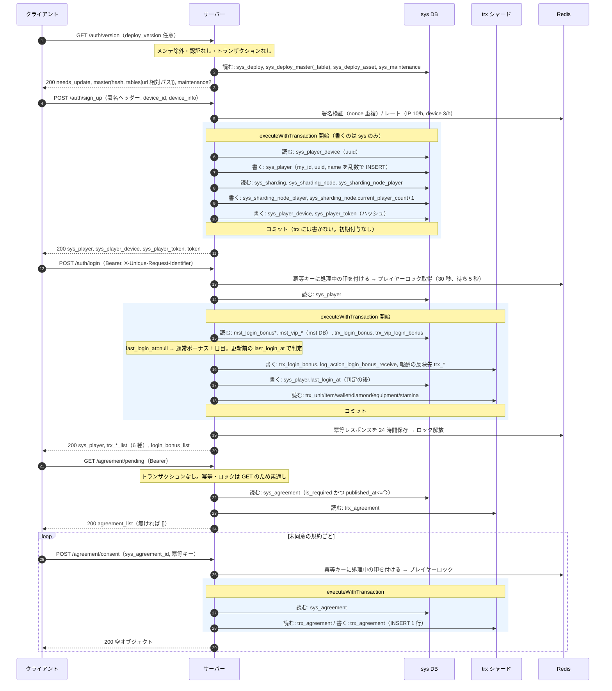
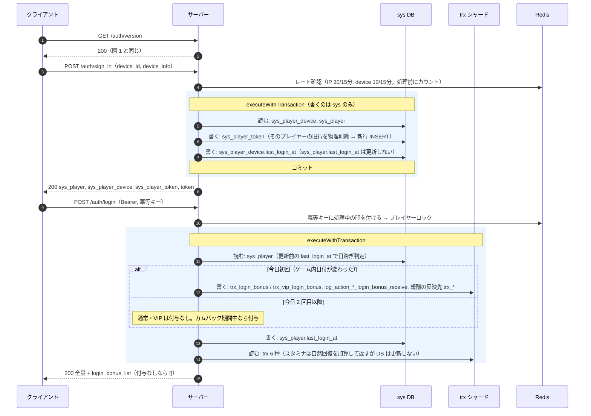
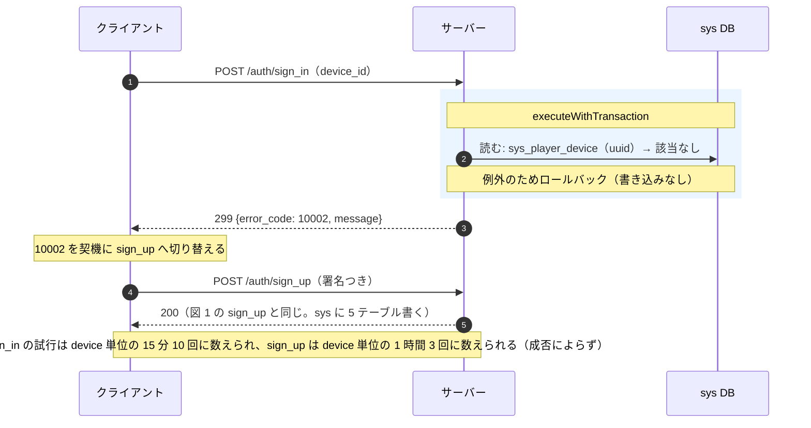
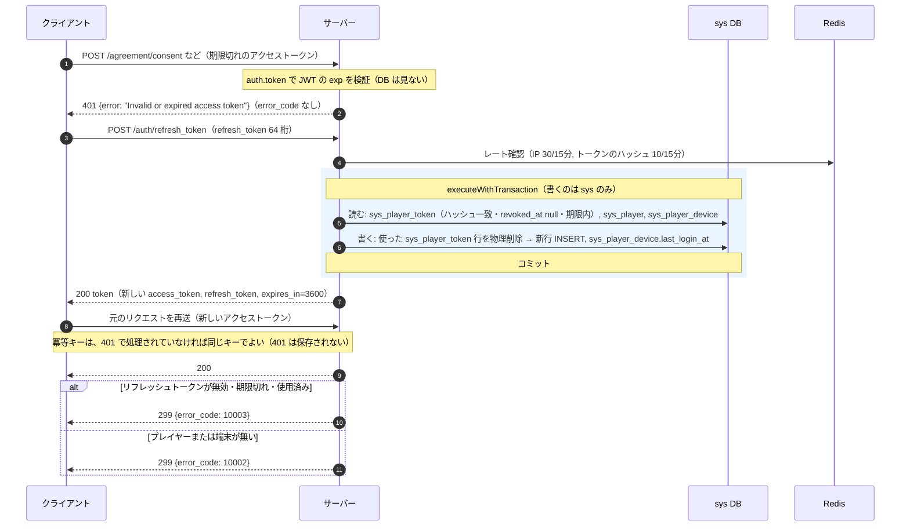
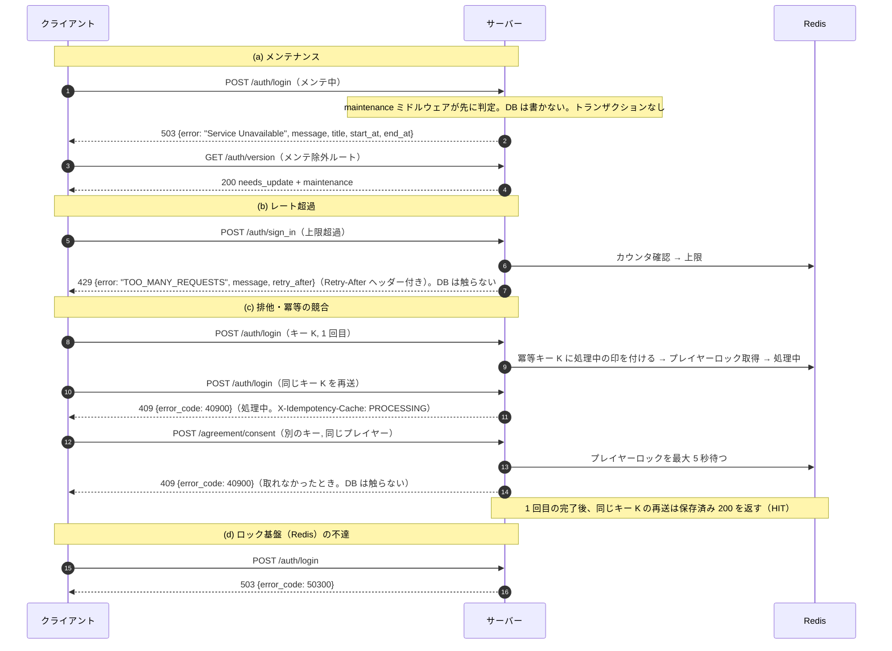

# タイトル〜ホーム シーケンス

既に実装済みの機能のシーケンス。実装が正。各図の注記に、トランザクション境界・書くテーブル・読むテーブルを書く。項目の詳細は [api.md](api.md)、テーブルは [db.md](db.md)。

共通の前提:
- `executeWithTransaction` は sys と全 trx シャードで同時にトランザクションを開始し、末尾でまとめてコミットする（途中で例外ならすべてロールバック）。
- 冪等・ロック・nonce・レート制限のカウンタは Redis（Cache）。DB テーブルではない。
- `CheckMasterHash` は全 API の応答後処理。`X-Master-Hash` があり、応答が HTTP 200 で、ハッシュが不一致のときだけ `X-Master-Update-Required: true` を付ける（図では省略）。

## 1. 新規（version → sign_up → login → agreement）

## 2. 既存（sign_in → login）

## 3. sign_in で未登録（10002）→ sign_up 切り替え

同じ `device_id` で既に登録済みの端末が sign_up すると、299 / 10004 が返る（sys_player_device に既存行があるため。書き込みなしでロールバック）。

## 4. トークン期限切れ（401 → refresh_token → 再送）

401 は冪等ミドルウェアより手前（`auth.token`）で返るので、冪等キーは消費されない。

## 5. 異常系（メンテナンス 503・レート超過 429・排他 409）

注記:
- (a) の 503 は `error_code` を持たない。メンテ除外ルートは `auth/version` `maintenance/status` `admin/maintenance/*` `up`。
- (c) の 409 は、冪等キーの処理中とプレイヤーロックの取得失敗のどちらも `error_code: 40900`。メッセージで区別でき、再試行すれば通る。
- 業務エラー（299）は冪等キーで保存されるため、再試行するときは新しいキーを使う（api.md 1 節）。
- (b) の sign_up の 429 は、署名検証の後に評価される（署名エラーは 401 で、カウントされない）。
